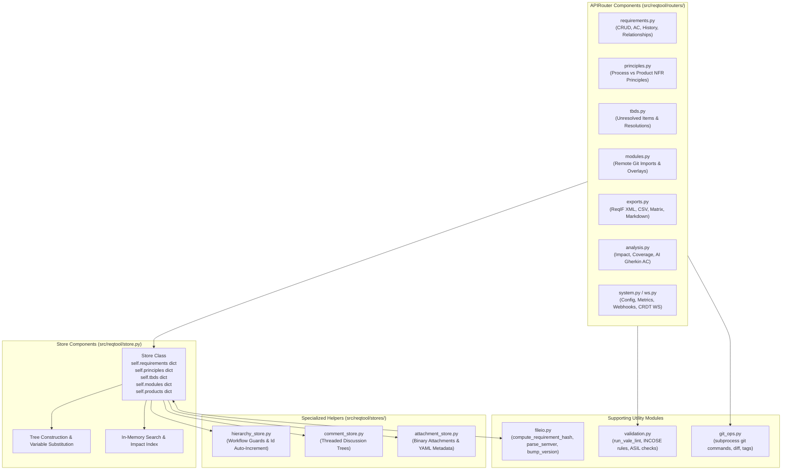
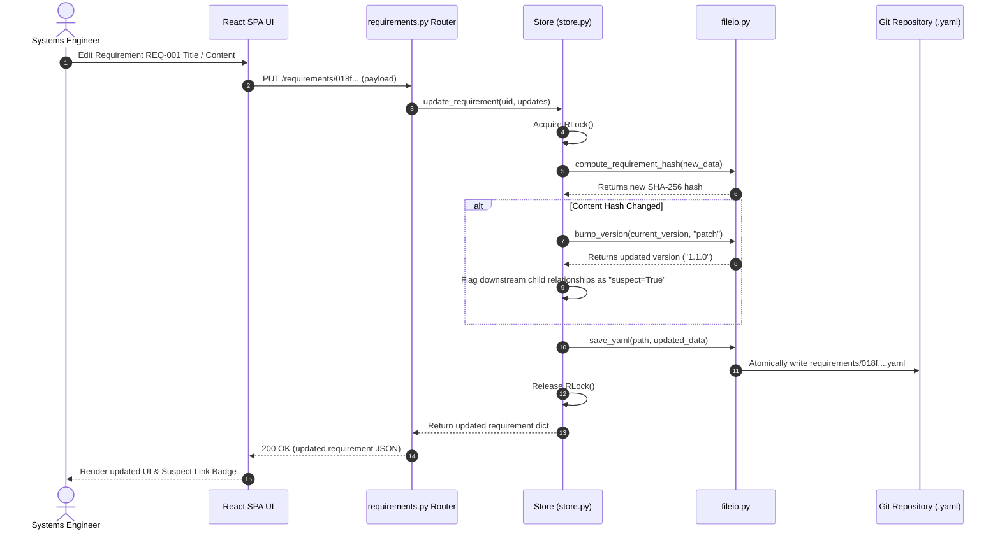
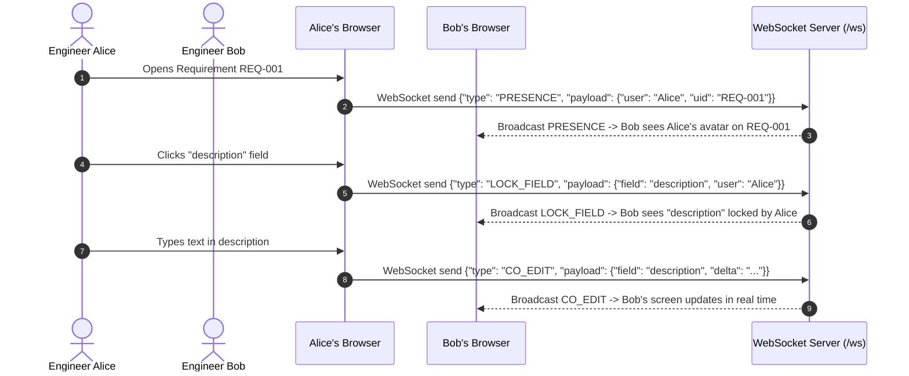
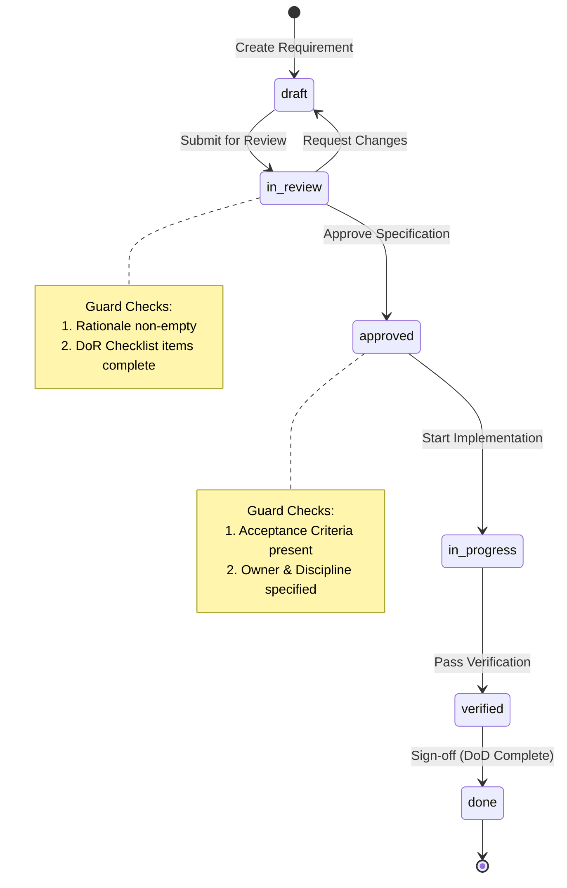

# reqtool — Architecture and Technical Reference

**Package Version:** `0.3.20`  
**Date:** September 28, 2026  

---

## 1. Purpose & Scope

`reqtool` is a Git-backed, YAML-based requirements management framework and workstation for systems and software engineering programmes. It supports both formal systems engineering specifications (stakeholder needs, functional, performance, safety, compliance requirements) and agile planning items (themes, initiatives, epics, features, stories) in a unified graph store.

The fundamental premise is that **requirements are source code artefacts**. Every requirement, principle, and TBD is stored as an individual human-readable `.yaml` file inside a Git repository. The tool layers SHA-256 content hashing, semantic versioning, workflow guard enforcement, automated INCOSE/Vale prose linting, impact analysis, and ReqIF export on top of that Git file store without hiding files from engineers.

---

## 2. C4 Architecture Model

### 2.1 C4 Level 1: System Context Diagram

The System Context Diagram shows how `reqtool` fits into the broader enterprise environment, interacting with engineers, CI/CD automation pipelines, Git hosting providers, and external regulatory tooling.

```mermaid
flowchart TD
    subgraph Users ["Users & Actors"]
        SE["Systems Engineer / Author"]
        PM["Product Manager / Lead"]
        Auditor["Safety / Compliance Auditor"]
    end

    subgraph ReqToolSystem ["reqtool System Boundary"]
        ReqTool["reqtool Requirements Workstation & API Server"]
    end

    subgraph ExternalEcosystem ["External Ecosystem & Tooling"]
        GitRepo[("Git Remote Repository (GitHub / GitLab / Azure DevOps)")]
        CICD["CI/CD Quality Gate (GitHub Actions / Jenkins)"]
        ValeLinter["Vale CLI Prose Linter Engine"]
        ReqIFTools["External ALM Tools (IBM DOORS / Polarion / PTC Integrity)"]
    end

    SE <-->|CLI & Web UI (HTTP/WS)| ReqTool
    PM <-->|Kanban & Roadmap UI| ReqTool
    Auditor <-->|Export Audit Packages (PDF/ReqIF)| ReqTool

    ReqTool <-->|YAML Read / Write & Git Commits| GitRepo
    CICD <-->|reqtool validate & pytest| ReqTool
    ReqTool <-->|Subprocess Prose Analysis| ValeLinter
    ReqTool <-->|ReqIF XML Import / Export| ReqIFTools
```

---

### 2.2 C4 Level 2: Container Diagram

The Container Diagram details the high-level software containers comprising `reqtool`: the Single-Page Application (SPA), the FastAPI Web Server, APIRouters, In-Memory Graph Store, specialized Domain Store helpers, File I/O Engine, and Git repository backend.

```mermaid
flowchart TD
    subgraph Browser ["Web Browser Container"]
        SPA["React SPA Workstation<br/>(Vite / D3 Network Graph / Tailwind CSS)"]
    end

    subgraph AppServer ["Python App Server Container (FastAPI / Uvicorn)"]
        WS_Server["WebSocket Manager<br/>(Real-Time CRDT Co-Editing / Presence)"]
        APIRouters["FastAPI APIRouters<br/>(requirements, principles, tbds, modules, exports, analysis)"]
        
        subgraph StoreLayer ["In-Memory Graph Store Layer"]
            GraphStore["Store (src/reqtool/store.py)<br/>threading.RLock · In-Memory Lookup · Impact Index"]
            AttStore["attachment_store.py"]
            ComStore["comment_store.py"]
            HierStore["hierarchy_store.py"]
        end

        ValEngine["Validation Engine & Vale Linter<br/>(INCOSE rules, safety ASIL, NFR constraints)"]
        FileIO["File I/O & Hashing Engine<br/>(ruamel.yaml · SHA-256 Hashing · SemVer 2.0.0)"]
    end

    subgraph Storage ["FileSystem & Git Container"]
        GitFS[("Git Repository Filesystem<br/>.reqtool/ · requirements/ · modules/ · products/")]
    end

    SPA <-->|HTTP REST API (Port 8765)| APIRouters
    SPA <-->|WebSockets (/ws)| WS_Server

    APIRouters --> GraphStore
    GraphStore --> AttStore
    GraphStore --> ComStore
    GraphStore --> HierStore
    
    APIRouters --> ValEngine
    GraphStore <--> FileIO
    FileIO <--> GitFS
```

---

### 2.3 C4 Level 3: Component Diagram (Backend & API Layer)

The Component Diagram breaks down the internal component relationships inside `src/reqtool/`:



---

## 3. Dynamic Behavior & Sequence Diagrams

### 3.1 Sequence Diagram: Requirement Mutation, Hashing & Suspect Link Flagging



---

### 3.2 Sequence Diagram: Real-Time Multi-User WebSocket CRDT Co-Editing



---

### 3.3 State Transition Diagram: Workflow Guard Mechanics



---

## 4. Storage & Hashing Integrity Specifications

### 4.1 Content Hashing Engine
The semantic content hash (`content_hash`) is a SHA-256 digest computed over all domain-significant requirement attributes ([fileio.py](file:///d:/Antigravity/Scratch/src/reqtool/fileio.py#L22)):
- Identity: `id`, `title`, `parentId`
- Core: `content.description`, `content.rationale`, `acceptance_criteria`
- Classification: `req_type`, `domain`, `discipline`, `status`, `priority`, `risk`
- Safety: `safety_related`, `safety_classification`, `safety_standard`, `asil_level`, `dal_level`
- Traceability & Planning: `relationships`, `links`, `attachments`, `target_release`, `custom_fields`

Edits to non-semantic metadata (such as discussion comments or local filter preferences) do not alter the `content_hash`, preventing unnecessary semantic version increments.

### 4.2 Semantic Versioning 2.0.0
Version strings follow SemVer 2.0.0 rules (`MAJOR.MINOR.PATCH[-PRERELEASE][+BUILD]`):
- **PATCH increment:** Non-breaking title or rationale clarifications.
- **MINOR increment:** Added acceptance criteria or new child relationships.
- **MAJOR increment:** Fundamental restructuring of requirement scope.
- **Build Metadata:** Build tags (`+build.20260928`, `+sha.a1b2c3d`) are supported via `parse_semver()` and `format_semver()`.
