# `reqtool` Documentation Hub

Welcome to the **`reqtool`** documentation hub. This directory contains comprehensive documentation covering installation, operational user guides, literature-backed requirements engineering philosophy, and C4 architecture models.

---

## Documentation Sitemap

| Document | Focus & Content |
| :--- | :--- |
| 📖 **[User Guide & Operations Manual](USER_GUIDE.md)** | End-to-end user guide covering CLI commands (`init`, `serve`, `validate`, `export`), FastAPI REST API endpoints, React UI Workstation views, workflow state transitions, custom fields, and module parameterization (`{{var}}`). |
| 🎓 **[Requirements Philosophy & Best Practices](REQUIREMENTS_PHILOSOPHY.md)** | Literature-backed requirements engineering philosophy drawing from **Robertson & Robertson** (*Mastering the Requirements Process* / Volere framework), **INCOSE Systems Engineering Handbook**, **ISO/IEC/IEEE 29148**, and **Karl Wiegers & Joy Beatty**. Explains how `reqtool` automates Volere schemas, INCOSE prose quality linting, suspect link tracking, and product principle constraints. |
| 🏗️ **[C4 Architecture & Technical Reference](ARCHITECTURE.md)** | Technical specification featuring C4 Model Diagrams (Level 1 System Context, Level 2 Container, Level 3 Component), Sequence Diagrams for requirement hashing/mutation and WebSocket CRDT co-editing, State Transition Diagrams, and storage specifications. |
| 🤝 **[Contributing Guidelines](CONTRIBUTING.md)** | Developer setup, testing guidelines, pull request submission process, and GitHub Copilot code review integration. |

---

## Core System Architecture Overview

```mermaid
flowchart TD
    subgraph Users ["Users & Clients"]
        SE["Systems Engineer / Author"]
        PM["Product Manager / Lead"]
        Auditor["Compliance Auditor"]
    end

    subgraph ReqToolSystem ["reqtool System Boundary"]
        UI["React SPA Workstation"]
        API["FastAPI App Server (Port 8765)"]
        Store["In-Memory Graph Store (src/reqtool/store.py)"]
        Val["Validation & INCOSE Linter Engine"]
    end

    subgraph Storage ["Git Repository Storage"]
        Disk[(".reqtool/ · requirements/ · modules/ · products/")]
    end

    SE <-->|Web UI & CLI| UI
    PM <-->|Kanban & Roadmap UI| UI
    Auditor <-->|ReqIF / PDF Audit Export| API

    UI <-->|HTTP REST & WebSockets| API
    API --> Store
    API --> Val
    Store <-->|YAML Serialization & Hashing| Disk
```

