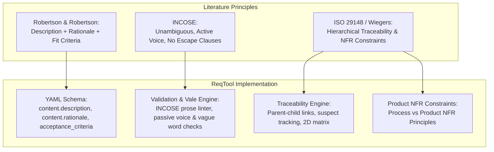

# Requirements Engineering Philosophy & Best Practices

> **"If you get the requirements right, you can fix the code. If you get the requirements wrong, you can build the wrong product perfectly."**

This document details the foundational engineering philosophy behind **`reqtool`**. It synthesizes established requirements engineering methodologies—specifically drawing from **Suzanne & James Robertson** (*Mastering the Requirements Process*), the **INCOSE Systems Engineering Handbook**, **ISO/IEC/IEEE 29148**, and **Karl Wiegers & Joy Beatty** (*Software Requirements*)—and explains how `reqtool` aligns with these principles to deliver robust, traceable, and audit-ready requirements management.

---

## 1. Grounding in Requirements Engineering Literature

### 1.1 The Volere Framework & Robertson & Robertson
In *Mastering the Requirements Process*, James and Suzanne Robertson introduced the **Volere Requirements Process**, emphasizing that a requirement is not merely a statement of functionality, but a complete specification of intent, justification, and verification criteria. Key tenets include:

- **Separation of Description and Rationale:** Every requirement must state *what* is needed alongside *why* it is needed (**Rationale**). Without rationale, engineers cannot evaluate trade-offs or determine if a proposed design change invalidates the requirement's underlying intent.
- **Fit Criteria (Acceptance Criteria):** A requirement without quantified fit criteria cannot be proven true or false. Fit criteria turn subjective requirements ("the system shall be fast") into objective, measurable tests ("99% of requests shall respond within 200 ms").
- **Customer Value & Originator:** Requirements must trace back to a specific stakeholder or business goal, preventing scope creep and unvalidated assumptions.

### 1.2 INCOSE Systems Engineering Standards
The **International Council on Systems Engineering (INCOSE)** defines strict characteristics for high-quality requirement statements:

1. **Necessary:** Defines an essential capability or constraint without which the system cannot meet its objective.
2. **Implementation-Independent:** Specifies *what* the system must achieve, not *how* to implement it in hardware or software code.
3. **Unambiguous:** Written such that it can only be interpreted in one way by all readers.
4. **Complete:** Contains all necessary information without missing preconditions or triggers.
5. **Consistent:** Free of conflicts with other requirements or principles.
6. **Verifiable:** Can be verified through inspection, analysis, demonstration, or testing.
7. **Traceable:** Uniquely identified and bidirectionally linked to higher-level needs and lower-level verification items.

INCOSE also establishes strict prose rules:
- Avoid **passive voice** ("it shall be considered..."). Use active voice with explicit subjects ("The Flight Controller shall...").
- Avoid **ambiguous words** (`fast`, `user-friendly`, `robust`, `seamless`, `reliable`, `flexible`).
- Avoid **escape clauses** (`if possible`, `where appropriate`, `to the extent practical`).

### 1.3 ISO/IEC/IEEE 29148 & Wiegers/Beatty Hierarchy
Standard **ISO/IEC/IEEE 29148** (*Systems and software engineering — Life cycle processes — Requirements engineering*) and Karl Wiegers' *Software Requirements* establish a clear hierarchy of requirement levels:

```
Business Needs / Themes (Strategic Intent)
  └── User / Stakeholder Needs & Initiatives (Capability Outcomes)
        └── System / Product Requirements & Epics (Functional & Performance Specifications)
              └── Subsystem / Component Requirements & Features / Stories (Concrete Deliverables)
```

Quality attributes (Non-Functional Requirements / NFRs) such as performance, security, availability, and safety must span and constrain all levels of this hierarchy.

---

## 2. How `reqtool` Aligns with Good Requirements Engineering

`reqtool` was built from the ground up to automate and enforce these exact literature-backed principles directly within modern developer workflows.



### 2.1 Enforced Volere Schema Structure
`reqtool` enforces the Robertson & Robertson schema in every requirement `.yaml` file:

```yaml
id: REQ-042
title: Flight Data Encryption
req_type: functional
domain: security
status: in_review
content:
  description: "The Telemetry Module shall encrypt all outbound telemetry packets using AES-256-GCM."
  rationale: "Prevents unauthorized eavesdropping and tampering over unencrypted RF links." # Robertson & Robertson Rationale
acceptance_criteria: # Volere Fit Criteria
  - id: AC-01
    text: "Given an outbound telemetry packet, when transmitted over RF, then the payload is encrypted with AES-256-GCM."
verification_method: test # INCOSE Verifiability
safety_related: true
safety_classification: ASIL_D # ISO 26262 Alignment
```

### 2.2 Automated INCOSE Prose Quality Linter
Rather than relying on periodic manual reviews, `reqtool` integrates real-time automated prose quality linting via its INCOSE rule engine and **Vale CLI**:

- **Passive Voice Detection:** Flags statements missing explicit subjects.
- **Ambiguity Scanner:** Identifies subjective terms like `user-friendly`, `robust`, `seamless`, `fast`.
- **Escape Clause Filter:** Flags conditional cop-outs (`if possible`, `where appropriate`).
- **Unquantified Terms Flag:** Highlights missing numeric bounds (`high`, `low`).

### 2.3 Suspect Link Tracking & Change Propagation
In complex engineering programs, changing a high-level specification often invalidates downstream implementation specs without engineers noticing. `reqtool` implements **Suspect Link Tracking**:
- When a parent requirement undergoes a semantic version bump (e.g. `1.0.0` → `1.1.0`), all child relationships are automatically marked as **Suspect**.
- Engineers must review the impact and explicitly clear the suspect flag.

### 2.4 Product Principles & NFR Constraint Enforcement
Process principles (e.g. "all code must undergo peer review") differ from Product NFR principles (e.g. "maximum latency under 50 ms"). `reqtool` supports **Product Principle Enforcement**:
- Product NFR principles define global quality constraints.
- `reqtool validate` checks that every product NFR principle is explicitly satisfied by at least one system requirement, preventing quality constraints from falling through the cracks.

---

## 3. Why Use `reqtool`?

| Traditional Requirement Tools (DOORS, Jama, Excel) | The `reqtool` Approach |
| :--- | :--- |
| **Monolithic Prop-Tech Lock-in:** Expensive proprietary databases that isolate requirements from source code. | **Git-Backed Single Source of Truth:** Requirements live as human-readable `.yaml` files alongside code in Git repositories. |
| **Manual & Slow Code Reviews:** Requirements reviews happen in isolated documents disconnected from pull requests. | **Git Branching & PR Code Review:** Full integration with Git PRs, CI/CD pipelines, and GitHub Copilot automated code reviews. |
| **Vague Prose & Missing Rationale:** Text fields often lack mandatory rationale or verifiable acceptance criteria. | **Automated Linter Gates:** Built-in INCOSE prose linter and mandatory Volere schema structure enforced on every `git commit`. |
| **Fragile Traceability:** Manual Excel matrix updates that break when requirements change. | **Automated 2D Matrices & Suspect Tracking:** Graph-based traceability matrix generation, suspect link tracking, and XML ReqIF export. |

---

## 4. How to Implement `reqtool` in Your Organization

1. **Step 1: Adopt the Standard Vocabulary**
   Choose your project hierarchy during `reqtool init`:
   - Use `reqtool init agile` for software teams (Theme → Initiative → Epic → Feature → Story).
   - Use `reqtool init systems` for formal systems/hardware teams (Stakeholder Need → Functional → Performance → Safety).
   - Use `reqtool init defaults` for hybrid embedded/agile programmes.

2. **Step 2: Enforce Validation in CI/CD & PRs**
   Add `reqtool validate` to your GitHub Actions or CI pipeline (`.github/workflows/ci.yml`). Block merges if requirements contain blocking schema errors or unmapped product principles.

3. **Step 3: Leverage Automated Quality Linters**
   Run `reqtool validate` locally or via the React UI workstation (`reqtool serve`) to inspect INCOSE prose warnings before submitting specifications for peer review.

4. **Step 4: Conduct Baselines & Regulatory Audits**
   Tag release milestones with `reqtool` baseline snapshots (`req baseline create v1.0`). Export formal 2D coverage matrices and ReqIF files for ISO 26262 / DO-178C certification audits.
