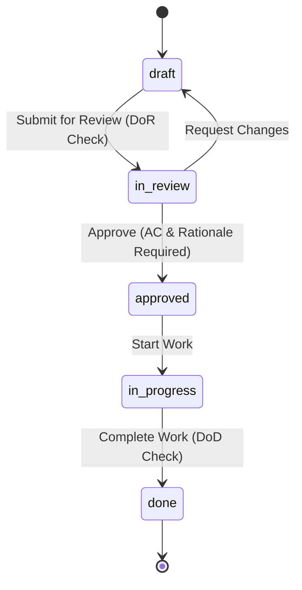

# `reqtool` Complete User Guide & Operations Manual

This guide provides end-to-end instructions for installing, configuring, and operating **`reqtool`** via the Command Line Interface (CLI), REST API, and React Web Workstation.

---

## 1. Installation & Environment Setup

### 1.1 Requirements
- Python **3.11** or higher.
- Git **2.30+**.
- Optional: `vale` CLI (for external prose style linting).

### 1.2 Installation Commands

**Standard Package Installation:**
```bash
pip install reqtool
```

**Local Wheel Installation:**
```bash
pip install dist/reqtool-0.3.20-py3-none-any.whl
```

**Editable Development Installation:**
```bash
git clone https://github.com/markbac/reqtool.git
cd reqtool
pip install -e ".[test]"
```

Verify the installation:
```bash
reqtool --help
```

---

## 2. Command Line Interface (CLI) Reference

`reqtool` (or alias `req`) provides comprehensive sub-commands:

### `reqtool init` — Initialise a Repository
Initialises a `.reqtool/` directory and creates configuration files:
```bash
reqtool init              # Blank repository
reqtool init agile        # Agile planning hierarchy (Theme/Initiative/Epic/Feature/Story)
reqtool init systems      # Systems engineering hierarchy (Stakeholder Need/Functional/Performance)
reqtool init defaults     # Combined Agile + Systems types with pre-populated principles
reqtool init demo         # Full IoT sensor demo dataset
```

### `reqtool serve` — Start API & Web Workstation
Launches the FastAPI backend and serves the embedded React UI workstation:
```bash
reqtool serve                     # Starts on http://localhost:8765
reqtool serve --port 8000         # Custom port
reqtool serve --host 0.0.0.0      # Bind all network interfaces
```

### `reqtool validate` — Run Validation & Prose Linter
Runs full schema, enum, hierarchy, safety, and INCOSE prose quality validation:
```bash
reqtool validate                  # Pretty console output (exits 1 on errors)
reqtool validate --json           # Machine-readable JSON output
reqtool validate --strict         # Treat warnings as blocking errors
```

### `reqtool export` — Export Artefacts
Exports requirements to various standard formats:
```bash
reqtool export --format csv       # Export to CSV
reqtool export --format reqif     # Export to standard ReqIF XML
reqtool export --format markdown  # Export to Markdown document
reqtool export --format jsx       # Export to React JSX component
```

### `reqtool diff` — Inspect Git Changes
Shows requirement modifications since a specified Git commit or tag:
```bash
reqtool diff HEAD~1               # Changes in last commit
reqtool diff v1.0.0               # Changes since tag v1.0.0
```

### `reqtool new-agile` — Create Agile Items
Interactively creates new agile planning items:
```bash
reqtool new-agile story "User Login"
reqtool new-agile epic "Authentication Subsystem"
```

---

## 3. React Web Workstation User Guide

Launching `reqtool serve` opens the interactive web workstation in your browser (`http://localhost:8765`).

```
┌─────────────────────────────────────────────────────────────────────────────┐
│ reqtool Workstation               [ Product: IoT Sensor ]  [Ctrl+K Search] │
├──────────────┬──────────────────────────────────────────────┬───────────────┤
│ TREE EXPLORER│ EDITOR & PROSE LINTER                        │ INSPECTOR     │
│ ├─ TH-001    │ Title: Battery Management System             │ Status: draft │
│ │  ├─ EP-01  │ Description: The Battery Controller shall... │ ASIL: ASIL_D  │
│ │  │  └─ US-1│ Rationale: Prevents thermal runaway...       │ Traceability: │
│ │            │ Acceptance Criteria:                         │ └─ SN-002     │
│ [Drag & Drop]│  - AC-01: Given battery voltage < 3.0V...   │ [Suspect Link]│
└──────────────┴──────────────────────────────────────────────┴───────────────┘
```

### 3.1 Multi-Level Tree Explorer View
- Located in the left sidebar.
- Displays nested requirement hierarchies (Themes → Initiatives → Epics → Features → Stories).
- **Drag-and-Drop Re-parenting:** Click and drag any node to re-parent it under a new parent requirement.

### 3.2 High-Density Bulk Grid View (Spreadsheet Mode)
- Access via **Tools** → **Bulk Editing Grid**.
- Enables rapid inline editing of titles, statuses, priorities, owners, and disciplines across hundreds of requirements simultaneously.
- Batch save changes with one click.

### 3.3 Interactive D3/Cytoscape Network Graph
- Access via **Traceability** → **Graph View**.
- Renders an interactive node graph visualizing bidirectional relationships between requirements, principles, and verification items.
- Zoom, pan, and click nodes to open detailed inspectors.

### 3.4 Side-by-Side Version Diff Inspector & Command Palette (`Ctrl+K`)
- **Command Palette:** Press `Ctrl+K` (or `Cmd+K`) anywhere in the application to instantly search requirements, trigger action shortcuts, or switch products.
- **Diff Inspector:** Compare historical git versions side-by-side with color-coded diff highlighting.

### 3.5 Release Roadmap & Kanban Board
- Access via **Kanban / Roadmap**.
- View requirements organized by workflow states (`Draft`, `In Review`, `Approved`, `Done`) or target release milestones.
- Drag-and-drop cards between columns to transition workflow states.

---

## 4. Workflows, State Transitions & Checklists

Requirements follow configurable workflow state transitions:



- **Definition of Ready (DoR):** Enforces mandatory checklist items (e.g. rationale present, acceptance criteria written) before transitioning to `in_review`.
- **Definition of Done (DoD):** Enforces verification completion checklist items before transitioning to `done`.

---

## 5. Modules, Variant Overlays & Parameter Substitution

### 5.1 Reusable Modules
Store shared requirements in `modules/<module-id>/_module.yaml`. Import external git repository modules using:
```bash
reqtool import <module-id>
```

### 5.2 Parameter Substitution & Overlays
Product manifests (`products/<product-id>/_product.yaml`) can parameterize shared module requirements using template variables:

```yaml
id: iot-sensor-v2
title: "IoT Sensor Variant 2"
variables:
  max_voltage: "12V"
  sampling_rate: "100Hz"
modules:
  - id: power-management-module
    overrides:
      REQ-010:
        priority: critical
```

Requirements containing `{{max_voltage}}` will automatically substitute `"12V"` during tree building and API export.
