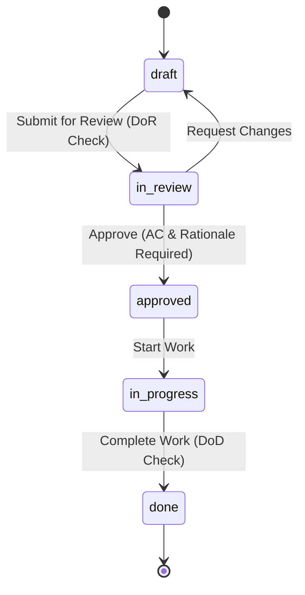

# `reqtool` Complete User Guide & Operations Manual

This guide provides end-to-end instructions for installing, configuring, and operating **`reqtool`** via the Command Line Interface (CLI), REST API, and React Web Workstation.

---

## 1. Installation & Environment Setup

### 1.1 Requirements
- Python **3.11** or higher.
- Git **2.30+**.
- Optional: `vale` CLI (for external prose style linting).

### 1.2 Installation Commands

**Standard Package Installation:**
```bash
pip install reqtool
```

**Local Wheel Installation:**
```bash
pip install dist/reqtool-0.3.20-py3-none-any.whl
```

**Editable Development Installation:**
```bash
git clone https://github.com/markbac/reqtool.git
cd reqtool
pip install -e ".[test]"
```

Verify the installation:
```bash
reqtool --help
```

---

## 2. Command Line Interface (CLI) Reference

`reqtool` (or alias `req`) provides comprehensive sub-commands:

### `reqtool init` — Initialise a Repository
Initialises a `.reqtool/` directory and creates configuration files:
```bash
reqtool init              # Blank repository
reqtool init agile        # Agile planning hierarchy (Theme/Initiative/Epic/Feature/Story)
reqtool init systems      # Systems engineering hierarchy (Stakeholder Need/Functional/Performance)
reqtool init defaults     # Combined Agile + Systems types with pre-populated principles
reqtool init demo         # Full IoT sensor demo dataset
```

### `reqtool serve` — Start API & Web Workstation
Launches the FastAPI backend and serves the embedded React UI workstation:
```bash
reqtool serve                     # Starts on http://localhost:8765
reqtool serve --port 8000         # Custom port
reqtool serve --auth required     # Require a login for every request
reqtool serve --host 0.0.0.0 --auth required   # Serve other machines (login mandatory)
```

By default the server runs in `local` mode: no login, but only this machine can connect. Binding any non-loopback address without `--auth required` is refused. See [section 6](#6-security-and-access-control).

### `reqtool user` -- Manage Accounts
No account exists until you create one. Create the first administrator, then others:
```bash
reqtool user add alice --role admin       # prompts for a password (minimum 8 characters)
reqtool user add bob --role editor
reqtool user passwd alice                 # reset a password
reqtool user list
```
Roles are `admin`, `editor` and `viewer`.

### `reqtool validate` — Run Validation & Prose Linter
Runs full schema, enum, hierarchy, safety, and INCOSE prose quality validation:
```bash
reqtool validate                  # Pretty console output (exits 1 on errors)
reqtool validate --json           # Machine-readable JSON output
reqtool validate --strict         # Treat warnings as blocking errors
```

### `reqtool export` — Export Artefacts
Exports requirements to various standard formats:
```bash
reqtool export --format csv       # Export to CSV
reqtool export --format reqif     # Export to standard ReqIF XML
reqtool export --format markdown  # Export to Markdown document
reqtool export --format jsx       # Export to React JSX component
```

### `reqtool diff` — Inspect Git Changes
Shows requirement modifications since a specified Git commit or tag:
```bash
reqtool diff HEAD~1               # Changes in last commit
reqtool diff v1.0.0               # Changes since tag v1.0.0
```

### `reqtool new-agile` — Create Agile Items
Interactively creates new agile planning items:
```bash
reqtool new-agile story "User Login"
reqtool new-agile epic "Authentication Subsystem"
```

---

## 3. React Web Workstation User Guide

Launching `reqtool serve` opens the interactive web workstation in your browser (`http://localhost:8765`).

```
┌─────────────────────────────────────────────────────────────────────────────┐
│ reqtool Workstation               [ Product: IoT Sensor ]  [Ctrl+K Search] │
├──────────────┬──────────────────────────────────────────────┬───────────────┤
│ TREE EXPLORER│ EDITOR & PROSE LINTER                        │ INSPECTOR     │
│ ├─ TH-001    │ Title: Battery Management System             │ Status: draft │
│ │  ├─ EP-01  │ Description: The Battery Controller shall... │ ASIL: ASIL_D  │
│ │  │  └─ US-1│ Rationale: Prevents thermal runaway...       │ Traceability: │
│ │            │ Acceptance Criteria:                         │ └─ SN-002     │
│ [Drag & Drop]│  - AC-01: Given battery voltage < 3.0V...   │ [Suspect Link]│
└──────────────┴──────────────────────────────────────────────┴───────────────┘
```

### 3.1 Multi-Level Tree Explorer View
- Located in the left sidebar.
- Displays nested requirement hierarchies (Themes → Initiatives → Epics → Features → Stories).
- **Drag-and-Drop Re-parenting:** Click and drag any node to re-parent it under a new parent requirement. Moving an item under itself or one of its own descendants is refused (`409 parent_cycle`). If a loop already exists in the files, validation reports `parent_cycle` and the tree shows each item once.

### 3.2 High-Density Bulk Grid View (Spreadsheet Mode)
- Access via **Tools** → **Bulk Editing Grid**.
- Enables rapid inline editing of titles, statuses, priorities, owners, and disciplines across hundreds of requirements simultaneously.
- Batch save changes with one click.

### 3.3 Interactive D3/Cytoscape Network Graph
- Access via **Traceability** → **Graph View**.
- Renders an interactive node graph visualizing bidirectional relationships between requirements, principles, and verification items.
- Zoom, pan, and click nodes to open detailed inspectors.

### 3.4 Side-by-Side Version Diff Inspector & Command Palette (`Ctrl+K`)
- **Command Palette:** Press `Ctrl+K` (or `Cmd+K`) anywhere in the application to instantly search requirements, trigger action shortcuts, or switch products.
- **Diff Inspector:** Compare historical git versions side-by-side with color-coded diff highlighting.

### 3.5 Release Roadmap & Kanban Board
- Access via **Kanban / Roadmap**.
- View requirements organized by workflow states (`Draft`, `In Review`, `Approved`, `Done`) or target release milestones.
- Drag-and-drop cards between columns to transition workflow states.

---

## 4. Workflows, State Transitions & Checklists

Requirements follow configurable workflow state transitions:



- **Definition of Ready (DoR):** Enforces mandatory checklist items (e.g. rationale present, acceptance criteria written) before transitioning to `in_review`.
- **Definition of Done (DoD):** Enforces verification completion checklist items before transitioning to `done`.

### 4.1 Parent/child type rules

`hierarchy.yaml` lists which item types may sit under which (`allowed_children`). The top-level `enforce` key controls how strictly this is applied:

| `enforce` | Behaviour |
|-----------|-----------|
| `off` | Rules are ignored. |
| `warn` (default) | Writes succeed; `req validate` reports a `hierarchy_violation` warning. |
| `error` | Creating or moving an item under a disallowed parent (or changing its type so it no longer fits) returns `409 hierarchy_violation`, and validation reports an error. Bulk updates report the failure per item. |

A parent type with no entry in `hierarchy` is unconstrained.

### 4.2 Relationship rules between layers

`cross_layer_rules` in `hierarchy.yaml` say which relationship types may link which item types. They follow the same `enforce` setting as 4.1:

- A pair of types is *governed* when a rule covers it in either direction. Only the relationship types listed for the exact direction are allowed, so a `physical` requirement cannot `satisfies` a `story` (the story satisfies the requirement).
- Pairs no rule mentions are unconstrained, and `relates_to` is always allowed.
- `warn` reports `relationship_violation` in validation; `error` also rejects *new* offending relationships with `409 relationship_violation` (relationships already stored never block unrelated edits).
- Themes, initiatives and epics may `traces_to` / `derived_from` stakeholder needs, and themes and initiatives may link to systems requirements like other agile items.

---

## 5. Modules, Variant Overlays & Parameter Substitution

### 5.1 Reusable Modules
Store shared requirements in `modules/<module-id>/_module.yaml`. Import external git repository modules using:
```bash
reqtool import <module-id>
```

### 5.2 Parameter Substitution & Overlays
Product manifests (`products/<product-id>/_product.yaml`) can parameterize shared module requirements using template variables:

```yaml
id: iot-sensor-v2
title: "IoT Sensor Variant 2"
variables:
  max_voltage: "12V"
  sampling_rate: "100Hz"
modules:
  - id: power-management-module
    overrides:
      REQ-010:
        priority: critical
```

Requirements containing `{{max_voltage}}` will automatically substitute `"12V"` during tree building and API export.

## 6. Security and Access Control

### 6.1 Authentication modes
| Mode | How to select | Who can connect | Login |
|---|---|---|---|
| `local` (default) | `reqtool serve` | This machine only (loopback). Other addresses receive 403. | Not required |
| `required` | `reqtool serve --auth required` or `REQTOOL_AUTH=required` | Anyone who can reach the port | Required for every call |

- `reqtool serve` refuses to start on a non-loopback `--host` unless `--auth required` is given.
- The `reqtool-server` executable always starts in `required` mode.
- If you put a reverse proxy on the same host in front of reqtool, every client appears to come from the loopback address. Use `required` mode in that case.
- Public in `required` mode: `/health`, `/version`, `/auth/login`, the web UI's static files and `/badge/*`.

### 6.2 Accounts and roles
There is no default account. Older repositories that still contain the `admin` / `admin123` account created by version 0.5.0 and earlier have that login refused. Reset it with `reqtool user passwd admin`.

| Role | Can do |
|---|---|
| `viewer` | Read everything. Cannot change anything. |
| `editor` | Read and write requirements, principles, TBDs, comments and approvals. |
| `admin` | Everything an editor can, plus users, repository switching, configuration, workflow, enums, custom fields and webhooks. |

Only a logged-in administrator can create users through the API. While no accounts exist, the first account can be created from the local machine (`POST /auth/users` or `reqtool user add`) and is always an administrator.

Send the token returned by `POST /auth/login` as `Authorization: Bearer <token>` (or `X-API-Key`). Browser downloads such as the audit package use an `access_token` query parameter, which is accepted on GET requests only. WebSocket clients connect to `/ws?token=<token>`. Deleting a user invalidates their token immediately. In the web UI, a 401 response opens the login dialog.

### 6.3 Approvals and signatures
- The approver is the logged-in user. Sending a different `approved_by` returns 403, and viewers cannot approve. In `local` mode the name in the request is recorded with `identity_verified: false`.
- Approval signatures (`SIG-v2`) cover the approved content, not only the version and user. `reqtool validate` reports:
  - an error `approval_signature_invalid` if the record or signature has been altered;
  - a warning `approval_stale` if the content changed after approval, which means it needs re-approval;
  - a warning `approval_signature_legacy` for older `SIG-v1` signatures, which cannot detect content changes. Re-approve to upgrade them.
- Approving, bulk-updating or cloning is refused while the working tree has unresolved merge conflicts, and a status change must be a legal workflow transition (409 `workflow_guard`).

### 6.4 Secrets
- `.reqtool/.secret_key` (signs tokens and approvals) and `.reqtool/users.yaml` (password hashes) are created with owner-only permissions and are added to `.gitignore` automatically. If either was ever committed, rotate the key and remove the files from history. Existing signatures stop verifying after rotation.
- Webhook secrets are write-only. The API returns `"secret": "********"` and `"has_secret": true`. Sending the placeholder back unchanged keeps the stored secret.

### 6.5 Environment variables
| Variable | Purpose |
|---|---|
| `REQTOOL_AUTH` | `local` or `required`. Same as `--auth`. |
| `REQTOOL_CORS_ORIGINS` | Comma-separated extra browser origins allowed to call the API. Localhost origins are always allowed. |
| `REQTOOL_REPO_ROOTS` | Path-separator-separated directories that `/repo/init` and `/repo/switch` may use. Unset means any directory. |
| `REQTOOL_DISABLE_REPO_SWITCH` | Set to `1` to disable `/repo/init` and `/repo/switch`. |
| `REQTOOL_REPO` | Default repository root. |
| `REQTOOL_API` | Base URL the CLI uses to reach a running server (default `http://localhost:8765`). |

`/repo/init` and `/repo/switch` are accepted only from the local machine, whatever the mode.

### 6.6 Other input restrictions
- Product and module IDs may contain letters, digits, `_`, `.` and `-` (maximum 64 characters, not starting with `.` or `-`).
- Git refs and baseline names that begin with `-`, contain `..` or whitespace are rejected with 422.
- Remote module `git_remote` values must be `https`, `http`, `ssh` or `git` URLs (or `user@host:path`). Local paths and `file://` are rejected, and git failures are reported instead of ignored.
- Rendered Markdown and diagram SVG are sanitised, so script, event handlers and `javascript:` links are removed.

## 7. Behaviour Notes

- **Commits:** committing a requirement or TBD commits only that file. Other staged changes stay staged. The commit SHA is no longer written into the YAML; the history view reads it from git. Committing with nothing staged returns 409.
- **History:** a requirement's change history is append-only. It is no longer cut to 20 entries.
- **Saving:** YAML files are written atomically (temporary file, then rename).
- **Configuration:** `PUT /config`, `PUT /workflow` and `PUT /enums/repo` validate before saving and return 422 with the field errors, so a bad request can no longer stop the repository loading.
- **Baselines:** `GET /baselines/{name}/diff` returns the changes since the baseline, and `GET /baselines/compare` compares the two baselines you name. Unknown baselines return 404.
- **Bulk update:** the response gains an `errors` map (uid to reason). Items whose status change is not a legal transition are listed in `failed`.
- **Real-time events:** WebSocket clients now receive server events such as `status_changed`.
