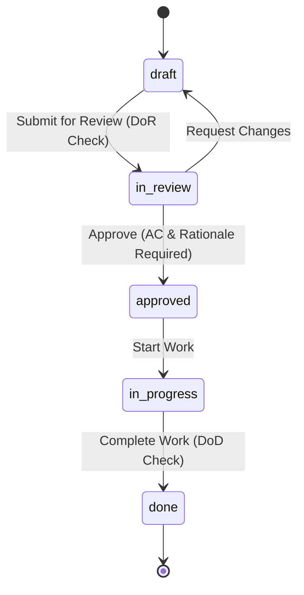

# `reqtool` Complete User Guide & Operations Manual

This guide provides end-to-end instructions for installing, configuring, and operating **`reqtool`** via the Command Line Interface (CLI), REST API, and React Web Workstation.

---

## 1. Installation & Environment Setup

### 1.1 Requirements
- Python **3.11** or higher.
- Git **2.30+**.
- Optional: `vale` CLI (for external prose style linting).

### 1.2 Installation Commands

**Standard Package Installation:**
```bash
pip install reqtool
```

**Local Wheel Installation:**
```bash
pip install dist/reqtool-0.3.20-py3-none-any.whl
```

**Editable Development Installation:**
```bash
git clone https://github.com/markbac/reqtool.git
cd reqtool
pip install -e ".[test]"
```

Verify the installation:
```bash
reqtool --help
```

---

## 2. Command Line Interface (CLI) Reference

`reqtool` (or alias `req`) provides comprehensive sub-commands:

### `reqtool init` — Initialise a Repository
Initialises a `.reqtool/` directory and creates configuration files:
```bash
reqtool init              # Blank repository
reqtool init agile        # Agile planning hierarchy (Theme/Initiative/Epic/Feature/Story)
reqtool init systems      # Systems engineering hierarchy (Stakeholder Need/Functional/Performance)
reqtool init defaults     # Combined Agile + Systems types with pre-populated principles
reqtool init demo         # Full IoT sensor demo dataset
```

### `reqtool serve` — Start API & Web Workstation
Launches the FastAPI backend and serves the embedded React UI workstation:
```bash
reqtool serve                     # Starts on http://localhost:8765
reqtool serve --port 8000         # Custom port
reqtool serve --auth required     # Require a login for every request
reqtool serve --host 0.0.0.0 --auth required   # Serve other machines (login mandatory)
```

By default the server runs in `local` mode: no login, but only this machine can connect. Binding any non-loopback address without `--auth required` is refused. See [section 6](#6-security-and-access-control).

### `reqtool user` -- Manage Accounts
No account exists until you create one. Create the first administrator, then others:
```bash
reqtool user add alice --role admin       # prompts for a password (minimum 8 characters)
reqtool user add bob --role editor
reqtool user passwd alice                 # reset a password
reqtool user list
```
Roles are `admin`, `editor` and `viewer`.

### `reqtool validate` — Run Validation & Prose Linter
Runs full schema, enum, hierarchy, safety, and INCOSE prose quality validation:
```bash
reqtool validate                  # Pretty console output (exits 1 on errors)
reqtool validate --json           # Machine-readable JSON output
reqtool validate --strict         # Treat warnings as blocking errors
```

### `reqtool export` — Export Artefacts
Exports requirements to various standard formats:
```bash
reqtool export --format csv       # Export to CSV
reqtool export --format reqif     # Export to standard ReqIF XML
reqtool export --format markdown  # Export to Markdown document
reqtool export --format jsx       # Export to React JSX component
```

### `reqtool diff` — Inspect Git Changes
Shows requirement modifications since a specified Git commit or tag:
```bash
reqtool diff HEAD~1               # Changes in last commit
reqtool diff v1.0.0               # Changes since tag v1.0.0
```

### `reqtool new-agile` — Create Agile Items
Interactively creates new agile planning items:
```bash
reqtool new-agile story "User Login"
reqtool new-agile epic "Authentication Subsystem"
```

---

## 3. React Web Workstation User Guide

Launching `reqtool serve` opens the interactive web workstation in your browser (`http://localhost:8765`).

```
┌─────────────────────────────────────────────────────────────────────────────┐
│ reqtool Workstation               [ Product: IoT Sensor ]  [Ctrl+K Search] │
├──────────────┬──────────────────────────────────────────────┬───────────────┤
│ TREE EXPLORER│ EDITOR & PROSE LINTER                        │ INSPECTOR     │
│ ├─ TH-001    │ Title: Battery Management System             │ Status: draft │
│ │  ├─ EP-01  │ Description: The Battery Controller shall... │ ASIL: ASIL_D  │
│ │  │  └─ US-1│ Rationale: Prevents thermal runaway...       │ Traceability: │
│ │            │ Acceptance Criteria:                         │ └─ SN-002     │
│ [Drag & Drop]│  - AC-01: Given battery voltage < 3.0V...   │ [Suspect Link]│
└──────────────┴──────────────────────────────────────────────┴───────────────┘
```

### 3.1 Multi-Level Tree Explorer View
- Located in the left sidebar.
- Displays nested requirement hierarchies (Themes → Initiatives → Epics → Features → Stories).
- **Add child:** right-click a node and choose **+ Add child**. The type of the new item comes from the parent's allowed child types (`GET /hierarchy/children/{type}`): if only one is allowed it is created straight away, otherwise a small menu lets you pick. Types with no allowed children (for example a task) say so instead of creating an item. **+ Add sibling** creates an item of the same type as the one you clicked.
- **Quick create:** the task sidebar and the empty editor offer Theme, Initiative, Epic, Feature, Story, Task, Bug and Spike. Theme, Initiative and Feature also have templates.
- **Drag-and-Drop Re-parenting:** Click and drag any node to re-parent it under a new parent requirement. Moving an item under itself or one of its own descendants is refused (`409 parent_cycle`). If a loop already exists in the files, validation reports `parent_cycle` and the tree shows each item once.

#### Suspect links

Saving a change to a requirement marks every relationship that points at it as *suspect* in the items that depend on it. Suspect links show as a warning count (`⚠ n`) on the tree node and as a `⚠ suspect` tag on the relationship row in the editor's Relations tab. The flag spreads transitively: if A changes, items that depend on A are flagged, and so are items that depend on those. Each newly flagged item gets a history entry ("Link to A became suspect") but no version bump, and the flag is not part of the content hash, so it never triggers `hash_mismatch` or makes an approval stale. Use **Review** to open the linked item, and **Clear suspect** once you have checked that the dependant is still correct. `req validate` warns (`suspect_link`) for approved items that still have suspect links, and `GET /metrics` reports `totals.suspect_links`.

### 3.2 High-Density Bulk Grid View (Spreadsheet Mode)
- Access via **Tools** → **Bulk Editing Grid**.
- Enables rapid inline editing of titles, statuses, priorities, owners, and disciplines across hundreds of requirements simultaneously.
- Batch save changes with one click.

### 3.3 Interactive D3/Cytoscape Network Graph
- Access via **Traceability** → **Graph View**.
- Renders an interactive node graph visualizing bidirectional relationships between requirements, principles, and verification items.
- Zoom, pan, and click nodes to open detailed inspectors.

### 3.4 Side-by-Side Version Diff Inspector & Command Palette (`Ctrl+K`)
- **Command Palette:** Press `Ctrl+K` (or `Cmd+K`) anywhere in the application to instantly search requirements, trigger action shortcuts, or switch products.
- **Diff Inspector:** Compare historical git versions side-by-side with color-coded diff highlighting.

### 3.5 Release Roadmap & Kanban Board
- Access via **Kanban / Roadmap**.
- View requirements organized by workflow states (`Draft`, `In Review`, `Approved`, `Done`) or target release milestones.
- Drag-and-drop cards between columns to transition workflow states.

### 3.6 Export and Templates
- **Export** (top bar) offers CSV, Markdown, JSX, ReqIF 1.2, PDF and the Audit Package. PDF downloads the whole specification (or one product if you enter its id) as `specification.pdf`, the same document as `GET`/`POST /export/pdf`.
- **Templates:** open **⋯ More > Templates** to view and manage the requirement templates used by the empty editor and the **+ New** button.

#### Progress and estimate rollups
- **Progress** (`GET /requirements/{uid}/progress`) is measured over the leaf items beneath a parent. The parent itself and any `cancelled` items are left out. An item counts as done when it is in a terminal state of its own type's workflow (for example `done`), so `active` does not count. Progress is weighted by estimate when the leaves have estimates, otherwise by item count.
- **Estimate rollup** (`GET /requirements/{uid}/rollup`) is the sum of the estimates of all leaf descendants, at any depth, excluding cancelled items. A parent's own estimate is never added, so nothing is double counted.

---

## 4. Workflows, State Transitions & Checklists

Requirements follow configurable workflow state transitions:



The editor shows the workflow of the item's own type (for example Themes, Initiatives and Stakeholder Needs use `draft -> active -> done`; sprint types use `backlog -> ready -> in_progress -> ...`), exactly as the server enforces it. Open sprint states can be moved to `cancelled`. `req validate` checks each workflow definition and warns about states that are unreachable, dead ends, or transitions to undefined states.

- **Definition of Ready (DoR):** Enforces mandatory checklist items (e.g. rationale present, acceptance criteria written) before transitioning to `in_review`.
- **Definition of Done (DoD):** Enforces verification completion checklist items before transitioning to `done`.

#### Closing a parent with open children

The `done` transition of the `lightweight` (theme, initiative) and `sprint` (epic, feature, story, task, bug, spike) workflows has a guard `requires_children_in: [done, cancelled]`. By default (`children_enforce: warn`) a parent can still be closed, and `req validate` warns (`open_children`) about it. Set `children_enforce: error` in `hierarchy.yaml` to refuse the transition with `409 workflow_guard` listing the open children, or `off` to switch the check off. Only direct, non-deleted children are checked.

### 4.1 Parent/child type rules

`hierarchy.yaml` lists which item types may sit under which (`allowed_children`). The top-level `enforce` key controls how strictly this is applied:

| `enforce` | Behaviour |
|-----------|-----------|
| `off` | Rules are ignored. |
| `warn` (default) | Writes succeed; `req validate` reports a `hierarchy_violation` warning. |
| `error` | Creating or moving an item under a disallowed parent (or changing its type so it no longer fits) returns `409 hierarchy_violation`, and validation reports an error. Bulk updates report the failure per item. |

A parent type with no entry in `hierarchy` is unconstrained.

### 4.2 Relationship rules between layers

`cross_layer_rules` in `hierarchy.yaml` say which relationship types may link which item types. They follow the same `enforce` setting as 4.1:

- A pair of types is *governed* when a rule covers it in either direction. Only the relationship types listed for the exact direction are allowed, so a `physical` requirement cannot `satisfies` a `story` (the story satisfies the requirement).
- Pairs no rule mentions are unconstrained, and `relates_to` is always allowed.
- `warn` reports `relationship_violation` in validation; `error` also rejects *new* offending relationships with `409 relationship_violation` (relationships already stored never block unrelated edits).
- Themes, initiatives and epics may `traces_to` / `derived_from` stakeholder needs, and themes and initiatives may link to systems requirements like other agile items.

### 4.3 Automation rules

Rules live in `.reqtool/automation_rules.yaml` and are edited in the **Automation Rules** panel. One rule looks like this:

```yaml
- id: rule-auto-tag-safety
  name: Auto-tag Safety Critical Items
  enabled: true
  event: requirement_created      # requirement_created | requirement_updated | requirement_approved | status_changed
  condition: {req_type: safety}   # every key must equal the event's value
  action: add_tag                 # set_field (target_field + target_value) | add_tag (target_value)
  target_value: ASIL-D
```

`GET /automation/schema` lists the supported events and actions, and `PUT /automation/rules` validates every rule before saving. An invalid rule returns `422` identifying the rule by position; the panel shows the message under that rule. Rules written in the older panel format (`actions: [...]`, dotted event names such as `requirement.created`) are rejected and must be re-created.

On a new repository the panel shows two example rules from memory. Nothing is written, and the examples do not run, until you save rules.

Rules run synchronously when the matching event is published (see the event list in the README). Conditions are compared with the event payload and the requirement's current fields, so `{status: approved}` on `requirement_approved` matches. Actions are idempotent (a field already holding the value, or a tag already present, is left alone), each execution is logged and recorded in the requirement's history, and changes made by rules do not publish events, so rules cannot trigger each other. Only the events listed above can trigger rules.

---

## 5. Modules, Variant Overlays & Parameter Substitution

### 5.1 Reusable Modules
Store shared requirements in `modules/<module-id>/_module.yaml`. Import external git repository modules using:
```bash
reqtool import <module-id>
```

### 5.2 Parameter Substitution & Overlays
Product manifests (`products/<product-id>/_product.yaml`) can parameterize shared module requirements using template variables:

```yaml
id: iot-sensor-v2
title: "IoT Sensor Variant 2"
variables:
  max_voltage: "12V"
  sampling_rate: "100Hz"
modules:
  - id: power-management-module
    overrides:
      REQ-010:
        priority: critical
```

Requirements containing `{{max_voltage}}` will automatically substitute `"12V"` during tree building and API export.

## 6. Security and Access Control

### 6.1 Authentication modes
| Mode | How to select | Who can connect | Login |
|---|---|---|---|
| `local` (default) | `reqtool serve` | This machine only (loopback). Other addresses receive 403. | Not required |
| `required` | `reqtool serve --auth required` or `REQTOOL_AUTH=required` | Anyone who can reach the port | Required for every call |

- `reqtool serve` refuses to start on a non-loopback `--host` unless `--auth required` is given.
- The `reqtool-server` executable always starts in `required` mode.
- If you put a reverse proxy on the same host in front of reqtool, every client appears to come from the loopback address. Use `required` mode in that case.
- Public in `required` mode: `/health`, `/version`, `/auth/login`, the web UI's static files and `/badge/*`.

### 6.2 Accounts and roles
There is no default account. Older repositories that still contain the `admin` / `admin123` account created by version 0.5.0 and earlier have that login refused. Reset it with `reqtool user passwd admin`.

| Role | Can do |
|---|---|
| `viewer` | Read everything. Cannot change anything. |
| `editor` | Read and write requirements, principles, TBDs, comments and approvals. |
| `admin` | Everything an editor can, plus users, repository switching, configuration, workflow, enums, custom fields and webhooks. |

Only a logged-in administrator can create users through the API. While no accounts exist, the first account can be created from the local machine (`POST /auth/users` or `reqtool user add`) and is always an administrator.

Send the token returned by `POST /auth/login` as `Authorization: Bearer <token>` (or `X-API-Key`). Browser downloads such as the audit package use an `access_token` query parameter, which is accepted on GET requests only. WebSocket clients connect to `/ws?token=<token>`. Tokens are standard signed JWTs (algorithm, issuer, audience and expiry are checked) that last 12 hours, after which the user logs in again. Deleting a user, changing their password or changing their role invalidates their existing tokens immediately. In the web UI, a 401 response opens the login dialog.

Passwords are stored as PBKDF2-HMAC-SHA256 with 600,000 iterations (the count is stored with each hash). Older, weaker hashes keep working and are upgraded automatically at the user's next login. Passwords are used exactly as typed, including leading and trailing spaces. After five failed logins within a minute for the same account or from the same address, `POST /auth/login` answers `429` with a `Retry-After` header. The counters are kept in memory, so they reset when the server restarts and are per process.

### 6.2d CSV import

`POST /import/csv/upload` (and **Import CSV** in the UI) is all or nothing. Every row is checked first: a title is required, IDs must be valid, unique within the file and not already used, parents must exist in the file or the repository, and each row needs the same number of columns as the header. If anything is wrong the response is `422` with a list of `{row, id, error}` and nothing is written. Add `?dry_run=true` to validate without importing.

Imported items start in their workflow's initial state, whatever the `status` column says, so nothing arrives pre-approved. An administrator can pass `?keep_status=true` to keep a valid `status` value. If the import fails while it is being applied, the items already created are removed again. Imports are not committed automatically; commit them as you would any other change.

### 6.2c Merges in progress

While a Git merge, rebase, cherry-pick or revert is in progress, or any file is unmerged, every write request (`POST`, `PUT`, `PATCH`, `DELETE`) returns `409 conflict`. Reads still work, and the `/git/`, `/repo/` and `/auth/` routes stay available so the conflict can be resolved. The check looks for Git's in-progress markers and unmerged index entries, so it costs a few milliseconds regardless of repository size.

### 6.2b Baselines

`POST /baselines` tags the last commit. If requirements, principles, decisions, TBDs, modules or products have uncommitted changes, it answers `409 dirty_working_tree` and lists the affected IDs, because the tag would not contain them. Commit first, or pass `allow_dirty: true` to proceed anyway. The tag message then records which items were left out. The Baselines panel asks for confirmation in the same situation.

### 6.2a Item IDs

A requirement's human ID (for example `FR-042`) is generated automatically, or you can supply one. Supplied IDs may contain letters, digits, `_`, `.` and `-` (up to 64 characters, not starting with `.` or `-`). Creating or renaming an item to an ID that another live item already uses returns `409 duplicate_id`; deleted items release their ID. `GET /requirements/{id}` accepts either the UID or the human ID, and `req validate` reports an error `duplicate_id` if duplicates arrive another way (for example a Git merge). Cloning picks `-COPY`, `-COPY2`, ... so clones never collide.

### 6.3 Approvals and signatures
- The approver is the logged-in user. Sending a different `approved_by` returns 403, and viewers cannot approve. In `local` mode the name in the request is recorded with `identity_verified: false`.
- Approval signatures (`SIG-v2`) cover the approved content, not only the version and user. `reqtool validate` reports:
  - an error `approval_signature_invalid` if the record or signature has been altered;
  - a warning `approval_stale` if the content changed after approval, which means it needs re-approval;
  - a warning `approval_signature_legacy` for older `SIG-v1` signatures, which cannot detect content changes. Re-approve to upgrade them.
- Approving, bulk-updating or cloning is refused while the working tree has unresolved merge conflicts, and a status change must be a legal workflow transition (409 `workflow_guard`).

### 6.4 Secrets
- `.reqtool/.secret_key` (signs tokens and approvals) and `.reqtool/users.yaml` (password hashes) are created with owner-only permissions and are added to `.gitignore` automatically. If either was ever committed, rotate the key and remove the files from history. Existing signatures stop verifying after rotation.
- `GET /ws` follows the same authentication as the API (`?token=` in `required` mode). A refused connection closes with code `4401` (login required) or `4403` (non-local client in local mode). Client messages are limited to 64 KB (close code `1009`), and only `PRESENCE`, `CURSOR`, `LOCK_FIELD`, `UNLOCK_FIELD` and `CO_EDIT` messages with an object payload are relayed.
- Webhook targets are resolved before every delivery and refused if any address is loopback, private, reserved or multicast. Link-local addresses (cloud metadata, `169.254.0.0/16`) are always refused. For an internal receiver set `allow_private: true` on that webhook in `config.yaml`. Redirects are never followed. The check runs just before sending, so a DNS answer that changes between the check and the connection is not fully excluded.
- Webhook secrets are write-only. The API returns `"secret": "********"` and `"has_secret": true`. Sending the placeholder back unchanged keeps the stored secret.

### 6.5 Environment variables
| Variable | Purpose |
|---|---|
| `REQTOOL_AUTH` | `local` or `required`. Same as `--auth`. |
| `REQTOOL_GITHUB_WEBHOOK_SECRET` | Shared secret for `POST /webhooks/github`. Requests must carry a matching `X-Hub-Signature-256` (HMAC-SHA256 of the body), otherwise `401`. Without a secret the endpoint is disabled (`503`). The endpoint is authenticated by its signature, not by a login. |
| `REQTOOL_MAX_UPLOAD_MB` | Largest attachment upload in megabytes (default `25`). Larger bodies get `413` and nothing is stored. Each item holds at most 100 attachments (`409` beyond that). |
| `REQTOOL_CORS_ORIGINS` | Comma-separated extra browser origins allowed to call the API. Localhost origins are always allowed. |
| `REQTOOL_REPO_ROOTS` | Path-separator-separated directories that `/repo/init` and `/repo/switch` may use. Unset means any directory. |
| `REQTOOL_DISABLE_REPO_SWITCH` | Set to `1` to disable `/repo/init` and `/repo/switch`. |
| `REQTOOL_REPO` | Default repository root. |
| `REQTOOL_API` | Base URL the CLI uses to reach a running server (default `http://localhost:8765`). |

`/repo/init` and `/repo/switch` are accepted only from the local machine, whatever the mode.

### 6.6 Other input restrictions
- Product and module IDs may contain letters, digits, `_`, `.` and `-` (maximum 64 characters, not starting with `.` or `-`).
- Git refs and baseline names that begin with `-`, contain `..` or whitespace are rejected with 422.
- Remote module `git_remote` values must be `https`, `http`, `ssh` or `git` URLs (or `user@host:path`). Local paths and `file://` are rejected, and git failures are reported instead of ignored.
- Rendered Markdown and diagram SVG are sanitised, so script, event handlers and `javascript:` links are removed.

## 7. Behaviour Notes

- **Commits:** committing a requirement or TBD commits only that file. Other staged changes stay staged. The commit SHA is no longer written into the YAML; the history view reads it from git. Committing with nothing staged returns 409.
- **History:** a requirement's change history is append-only. It is no longer cut to 20 entries.
- **Saving:** YAML files are written atomically (temporary file, then rename).
- **Configuration:** `PUT /config`, `PUT /workflow` and `PUT /enums/repo` validate before saving and return 422 with the field errors, so a bad request can no longer stop the repository loading.
- **Baselines:** `GET /baselines/{name}/diff` returns the changes since the baseline, and `GET /baselines/compare` compares the two baselines you name. Unknown baselines return 404.
- **Bulk update:** the response gains an `errors` map (uid to reason). Items whose status change is not a legal transition are listed in `failed`.
- **Real-time events:** WebSocket clients now receive server events such as `status_changed`.
