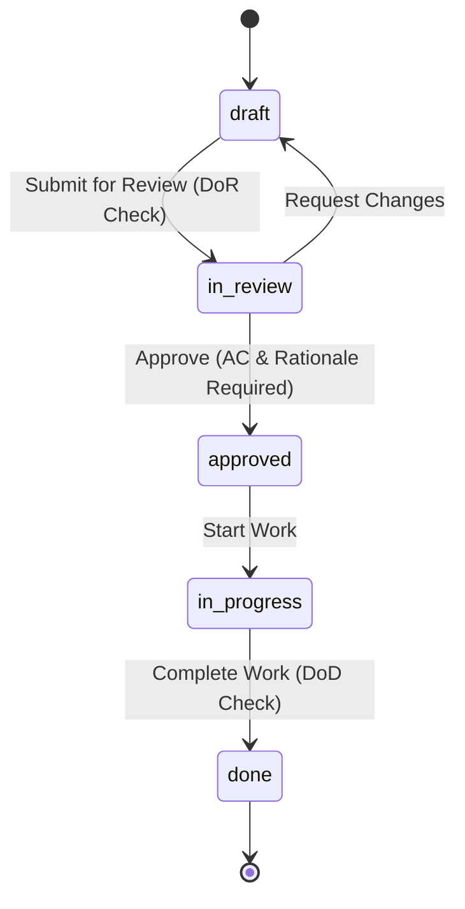
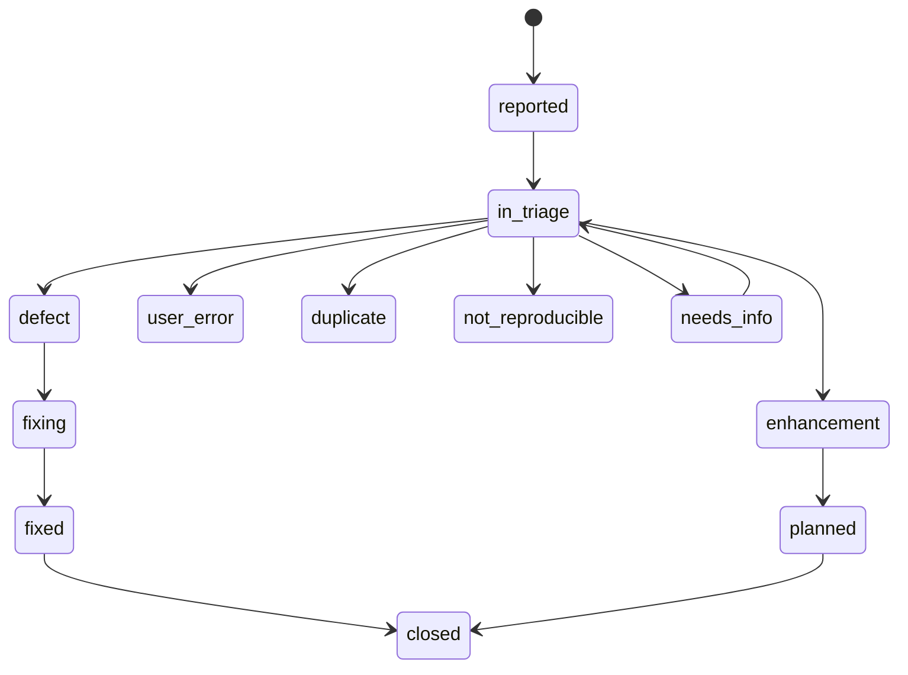

# `reqtool` Complete User Guide & Operations Manual

This guide provides end-to-end instructions for installing, configuring, and operating **`reqtool`** via the Command Line Interface (CLI), REST API, and React Web Workstation.

---

## 1. Installation & Environment Setup

### 1.1 Requirements
- Python **3.11** or higher.
- Git **2.30+**.
- Optional: `vale` CLI (for external prose style linting).

### 1.2 Installation Commands

**Standard Package Installation:**
```bash
pip install reqtool
```

**Local Wheel Installation:**
```bash
pip install dist/reqtool-0.3.20-py3-none-any.whl
```

**Editable Development Installation:**
```bash
git clone https://github.com/markbac/reqtool.git
cd reqtool
pip install -e ".[test]"
```

Verify the installation:
```bash
reqtool --help
```

---

## 2. Command Line Interface (CLI) Reference

`reqtool` (or alias `req`) provides comprehensive sub-commands:

### `reqtool init` — Initialise a Repository
Initialises a `.reqtool/` directory and creates configuration files:
```bash
reqtool init              # Blank repository
reqtool init agile        # Agile planning hierarchy (Theme/Initiative/Epic/Feature/Story)
reqtool init systems      # Systems engineering hierarchy (Stakeholder Need/Functional/Performance)
reqtool init defaults     # Combined Agile + Systems types with pre-populated principles
reqtool init demo         # Sentinel product family demo (see below)
```

`init defaults`, `init agile` and `init systems` also load engineering principles as *packs*, one per area (see section 3.9). Choose them with `--principles`:
```bash
reqtool init agile --principles all                    # every area
reqtool init agile --principles none                   # no principles
reqtool init systems --principles security,operations  # a list
```
Without the option, a terminal asks (the answer defaults to a set suited to the variant) and a script gets that default. An unknown area stops the command before anything is written. Later, `req principles packs` lists the packs and how many of their principles you have, `req principles add-pack <area>...` (or `all`) adds more without duplicating anything, and `req principles place` gives older principles an area and category (`req migrate` does this too).

**The demo.** `reqtool init demo` builds *Sentinel*, a made-up IoT product family, so every screen has something real to show. It has seven products (the environmental sensor, a Thread gateway, a cloud platform, a companion app, and Pro, Lite and Industrial variants built from shared modules), about 250 needs and systems requirements in every workflow state, three themes down to eight initiatives, 14 epics, 10 features, 74 stories, 37 tasks, defects and spikes, and 14 issues that cover every triage outcome. Five sprints (three finished, one running, one planned) and three phase gates have dated status history, so the burn-up, flow and kanban views show real movement, a few items are stuck, and one story was closed with an open task by forcing a parent and child rule with a reason. It also has 14 decisions (including a superseded one and a rejected one), 15 open questions (some resolved into decisions), around 130 principles from the packs with citations for the heatmap, comments, review requests, attachments, saved views and automation rules. Baselines and change sets need git history, so a new demo has none: run `git init` and commit, then create them. Dates are relative to the day the demo is made.

### `reqtool serve` — Start API & Web Workstation
Launches the FastAPI backend and serves the embedded React UI workstation:
```bash
reqtool serve                     # Starts on http://localhost:8765
reqtool serve --port 8000         # Custom port
reqtool serve --auth required     # Require a login for every request
reqtool serve --host 0.0.0.0 --auth required   # Serve other machines (login mandatory)
```

By default the server runs in `local` mode: no login, but only this machine can connect. Binding any non-loopback address without `--auth required` is refused. See [section 6](#6-security-and-access-control).

### `reqtool user` -- Manage Accounts
No account exists until you create one. Create the first administrator, then others:
```bash
reqtool user add alice --role admin       # prompts for a password (minimum 8 characters)
reqtool user add bob --role editor
reqtool user passwd alice                 # reset a password
reqtool user list
```
Roles are `admin`, `editor` and `viewer`.

### `reqtool validate` — Run Validation & Prose Linter
Runs full schema, enum, hierarchy, safety, and INCOSE prose quality validation:
```bash
reqtool validate                  # Pretty console output (exits 1 on errors)
reqtool validate --json           # Machine-readable JSON output
reqtool validate --strict         # Treat warnings as blocking errors
reqtool validate --rules          # Also check the parent and child rules (section 4.0b); forced items are shown, not failed
```

### `reqtool tools` -- Check and Install Tools
```bash
reqtool tools                 # check git, Node.js and Vale, and install Vale if it is missing
reqtool tools --check         # only report
reqtool tools --force         # try the Vale download again after a failure
reqtool tools --vale-version 3.9.1
```
Vale is downloaded from its GitHub release, checked against the release's SHA-256 sums and kept in `~/.reqtool/tools` (set `REQTOOL_TOOLS_DIR` to move it), so no administrator rights are needed. After a failed download the setup scripts wait 24 hours before trying again. Python and git are required (the command exits 1 without them), Node.js is only needed to build the web UI from source, and installing it is left to you.

### `reqtool lint` -- Writing Check
Checks the wording of requirements, principles and decisions with the rules in `.reqtool/lint.yaml` (see section 4.4):
```bash
reqtool lint                          # list findings, exit 1 if any is a warning or worse
reqtool lint --fail-on error          # only errors fail the run
reqtool lint --fail-on never          # report only
reqtool lint --format json            # machine-readable
```

### `reqtool export` — Export Artefacts
Exports requirements to various standard formats:
```bash
reqtool export --format csv       # Export to CSV
reqtool export --format reqif     # Export to standard ReqIF XML
reqtool export --format markdown  # Export to Markdown document
reqtool export --format jsx       # Export to React JSX component
```

### `reqtool diff` — Inspect Git Changes
Shows requirement modifications since a specified Git commit or tag:
```bash
reqtool diff HEAD~1               # Changes in last commit
reqtool diff v1.0.0               # Changes since tag v1.0.0
```

### `reqtool gate`, `doctor`, `query`, `test-results`, `snapshot` -- Delivery Checks
These commands work on the repository files and need no server:
```bash
reqtool gate [--product P1]            # release-readiness gate: open TBDs, unverified safety items, suspect links, trace gaps. Exits 1 on findings
reqtool doctor                         # configuration, secrets hygiene, dependency, hierarchy and stray-file checks. Exits 1 on errors
reqtool query 'status = approved AND priority = high'   # query language over requirements
reqtool test-results junit.xml [--source ci] [--run-url URL]   # set verification status from JUnit XML (test names carry a requirement id such as FR-042)
reqtool snapshot [--baseline NAME] [--out snapshot]    # static read-only site for stakeholders
```
`gate` is also available as a GitHub Action (`.github/actions/req-gate`) so a pull request can fail on an unready release. JUnit files containing a `DOCTYPE` or `ENTITY` declaration are rejected.

### `reqtool new-agile` — Create Agile Items
Interactively creates new agile planning items:
```bash
reqtool new-agile story "User Login"
reqtool new-agile epic "Authentication Subsystem"
```

---

## 3. React Web Workstation User Guide

Launching `reqtool serve` opens the interactive web workstation in your browser (`http://localhost:8765`).

```
┌─────────────────────────────────────────────────────────────────────────────┐
│ reqtool Workstation               [ Product: IoT Sensor ]  [Ctrl+K Search] │
├──────────────┬──────────────────────────────────────────────┬───────────────┤
│ TREE EXPLORER│ EDITOR & PROSE LINTER                        │ INSPECTOR     │
│ ├─ TH-001    │ Title: Battery Management System             │ Status: draft │
│ │  ├─ EP-01  │ Description: The Battery Controller shall... │ ASIL: ASIL_D  │
│ │  │  └─ US-1│ Rationale: Prevents thermal runaway...       │ Traceability: │
│ │            │ Acceptance Criteria:                         │ └─ SN-002     │
│ [Drag & Drop]│  - AC-01: Given battery voltage < 3.0V...   │ [Suspect Link]│
└──────────────┴──────────────────────────────────────────────┴───────────────┘
```

### 3.1 Multi-Level Tree Explorer View
- Located in the left sidebar.
- Displays nested requirement hierarchies (Themes → Initiatives → Epics → Features → Stories).
- **Add child:** right-click a node and choose **+ Add child**. The type of the new item comes from the parent's allowed child types (`GET /hierarchy/children/{type}`): if only one is allowed it is created straight away, otherwise a small menu lets you pick. Types with no allowed children (for example a task) say so instead of creating an item. **+ Add sibling** creates an item of the same type as the one you clicked.
- **Quick create:** the empty editor (nothing selected) lists every item type your repository defines in `.reqtool/hierarchy.yaml`, top-level types first, and creates the item at once, opens it and adds it to the tree. Select a product first. The **From template** cards beside it do the same with a template's fields filled in, as do **Use** in **⋯ More > Templates** and the templates in Help. Viewers see no create buttons.
- **Move to...:** right-click a node and choose **⇄ Move to...** to pick a new parent from a searchable list (or **(top level)** for no parent). Only parents the hierarchy allows can be chosen: the others are greyed out, and hovering shows why (for example "A story cannot go under a theme"). It works with the keyboard and screen readers.
- **Drag and drop:** drag a node onto the parent you want, or onto the empty part of the tree to make it a top-level item. The target is outlined green when the move is allowed and red when it is not. Moving an item onto itself or one of its own descendants is refused with a message (the server also refuses it with `409 parent_cycle`). Unsaved changes to the item must be saved or discarded first. If a loop already exists in the files, validation reports `parent_cycle` and the tree shows each item once.

#### Suspect links

Saving a change to a requirement marks every relationship that points at it as *suspect* in the items that depend on it. Suspect links show as a warning count (`⚠ n`) on the tree node and as a `⚠ suspect` tag on the relationship row in the editor's Relations tab. The flag spreads transitively: if A changes, items that depend on A are flagged, and so are items that depend on those. Each newly flagged item gets a history entry ("Link to A became suspect") but no version bump, and the flag is not part of the content hash, so it never triggers `hash_mismatch` or makes an approval stale. Use **Review** to open the linked item, and **Clear suspect** once you have checked that the dependant is still correct. `req validate` warns (`suspect_link`) for approved items that still have suspect links, and `GET /metrics` reports `totals.suspect_links`.

### 3.2 Bulk update
- Access via **⋯ More > Bulk update** (editors and administrators).
- Select several requirements and set a field on all of them in one commit.

### 3.3 Traceability grid and matrix
- Access via **⋯ More > Traceability**. It has two tabs.
- **Requirements × links** is the grid. Pick what runs across the top (**Tests**, **Modules** or **Decisions**), tick **Only requirements with no link** to list the gaps, page through long lists, and use **Download CSV** to take the grid away. A cell is ticked when the requirement is linked and the tooltip gives the state of what it is linked to. A requirement with no link carries a red **no link** tag. Only the 40 most used columns are drawn, and the header says how many were left out. `GET /traceability/grid` returns the same data (`columns`, `gaps`, `offset`, `limit`, `format=csv`).
- **Requirements × teams** is the older matrix of the `Allocated To` teams.
- Tests are the test-case links on an item's acceptance criteria. Modules are its `Allocated To` list. Decisions are the decisions that name it in their affected requirements.

### 3.3a Views
**⋯ More > Views** draws the work in eight ways. Each picture has a table or text form beside it, and every item in it opens in the editor when clicked.
- **Hierarchy:** the tree of items with their status colour. Filter by type and by status (parents of matches are kept so the shape stays readable), collapse or expand all, and see "Showing N of M" when a very large tree is cut at 400 items.
- **Type structure:** which type may sit under which (the rules in `hierarchy.yaml`) as a diagram. **Export Mermaid**, **Save SVG** and **Save PNG** take it away.
- **Coverage:** a treemap of the hierarchy, each box sized by the items at or below it and striped by status or by verification state. **Show table** gives the same numbers as a table, and the legend names every colour.
- **Impact:** everything within one to three hops of an item: parent, children, linked items both ways, the decisions that affect it and the modules it is allocated to. It opens on the item you have selected. Filter by type; at most 60 items are drawn, nearest first, and a table lists them.
- **Flow:** for each workflow, how many items sit in each state, their average and longest time there, and the ones stuck longer than 14 days. Change the limit on the page, or in `.reqtool/hierarchy.yaml`:

```yaml
flow:
  stuck_days: 14          # default for every state
  states:
    in_review: 5          # a shorter limit for one state
```

  Time in a state comes from the move recorded in the item's history (`status_from`, `status_to`); items moved before this was recorded count from when they were created. An item that has children (an epic waiting on its stories, say) is a container and is never counted as stuck.
- **Burn-up:** for one iteration, the scope and the work done over time, in the repository's estimate unit (an item with no estimate counts as one). Scope is dated by when each item was created or the iteration started, because the tool does not record when an item was assigned to an iteration.
- **Decision ageing:** open decisions and open questions, those blocking the most items first, with their age and the items they block.
- **Principles:** a heatmap of area and category against how many requirements cite each principle. Dashed boxes are principles nothing cites; a list shows the requirements that cite none.

The same data is served by `GET /views/hierarchy`, `/views/type-structure`, `/views/coverage`, `/views/impact/{uid}`, `/views/flow`, `/views/burnup/{iteration}`, `/views/decisions` and `/views/principles`.

### 3.3b The More menu
**⋯ More** groups its tools under headings, and hides a heading when your role can use nothing under it: **View** (Overview, Roadmap, Views, Coverage, Traceability, Decisions & ADRs, Query, Inbox), **Create and import** (Bulk update, Import CSV, Iterations & Gates, Change sets, Diagram Canvas), **Quality** (Writing check, Duplicate Detector), **Configure** (Workflows, Vocabularies, Custom fields, Templates, Automation Rules), **Admin** (Modules, Baselines, Webhooks, Repository) and **Account** (Login / Server). Type in the box at the top to find a tool, press Enter to open the first match, use the arrow keys, Home and End to move and Esc to close. The fallback workflow is edited from **More > Workflows**.

### 3.4 Side-by-Side Version Diff Inspector & Command Palette (`Ctrl+K`)
- **Command Palette:** Press `Ctrl+K` (or `Cmd+K`) anywhere in the application to instantly search requirements, trigger action shortcuts, or switch products.
- **Diff Inspector:** Compare historical git versions side-by-side with color-coded diff highlighting.

### 3.5 Release Roadmap & Kanban Board
- **Roadmap:** **⋯ More > Roadmap** has a **List** (Theme, Initiative, Epic with progress and health) and a **Board**. The board has one lane per theme and one column per target release (or per iteration, from the **Columns** menu), with an **unplanned** column for items with no release. Each card shows its progress. Editors and administrators drag a card to another column, or use the menu on the card, to set its release or iteration; viewers see the board read-only. Dependencies (`depends_on`) between themes and initiatives are listed under the board and the longest chain is marked.
- **Kanban:** **Task Mgmt** in the sidebar. Columns are workflow states (pick a type to see that type's own workflow). Cards show their parent, what they wait on (⛔), how many children are still open, and a **⚠ rule** marker when they break a parent and child rule.
- Drag a card to another column, or use the **Move to** menu on the card (keyboard users: Tab to the card, then the menu). A move that needs something the item lacks, or that a rule comments on, opens the same pop-up as the editor so you can fill it in, force it with a reason where your role allows it, or accept suggested moves for the parent. Cancelling leaves the board as it was.
- Viewers see the board but cannot drag, move or create. **+ New** creates an item of the chosen type through the same path as quick create. The iteration and person filters are lists taken from the repository.
- See 3.8 for how columns are chosen.

#### Paging and the Coverage panel
`GET /requirements` accepts `limit` (1 to 10000) and `offset`, sorted by ID, and always returns the number of matching items in the `X-Total-Count` response header. Without `limit` it returns everything, as before. The **Coverage** panel now reads the server-side summary from `GET /metrics` (status, priority and quality gaps) instead of downloading every requirement, so it matches the Metrics dashboard.

### 3.6 Robustness and panels
- **Duplicate Detector** (**⋯ More > Duplicate Detector**) lists likely duplicate pairs with both IDs, both titles and the similarity score. Click either side to open that requirement.
- **Iteration metrics** (`GET /iterations/{id}/metrics`) count the requirements whose **Iteration** field equals the iteration's id or title (deleted ones are excluded), so assigning a requirement changes the totals, approved/draft counts and completion percentage. The older `iteration_id` field was removed; existing files that have it are read as `iteration`.
- **Iterations** created without a methodology (for example through the API or CLI) are shown and returned as `scrum`.
- If a panel hits an unexpected error it is closed and a dismissable message shows the error. If the whole interface fails, a **Try again / Reload** screen is shown instead of a blank page.

### 3.7 Export and Templates
- **Export** (top bar) offers CSV, Markdown, JSX, ReqIF 1.2, PDF and the Audit Package. PDF downloads the whole specification (or one product if you enter its id) as `specification.pdf`, the same document as `GET`/`POST /export/pdf`.
- **PDF details:** the PDF embeds DejaVu Sans, so Latin, Greek, Cyrillic and many technical symbols print correctly. The cover shows the **Source Revision**: the Git commit it was generated from, whether the working tree was `clean` or had `uncommitted changes`, and any `baseline/*` tag on that commit. The table of contents has page numbers and the PDF has an outline. The running header and the footer (for example the classification label) are set in `.reqtool/config.yaml`:

```yaml
export:
  pdf:
    header_text: "ACME Product Specification"
    footer_text: "ACME RESTRICTED"
    fallback_font: /usr/share/fonts/truetype/wqy/wqy-microhei.ttc   # for Chinese, Japanese and Korean text
```

  Chinese, Japanese and Korean text needs a TrueType font with glyph outlines: set `fallback_font` to a `.ttf` or `.ttc` file, or install one that is found automatically (WenQuanYi, Droid Sans Fallback, Arial Unicode, Microsoft YaHei and SimSun are tried). Noto Sans CJK in its usual OpenType (CFF) form cannot be embedded and is skipped with a warning; without a usable font those characters are not drawn.
- **Templates:** open **⋯ More > Templates** to view and manage the requirement templates used by the empty editor and the **+ New** button.

#### Progress and estimate rollups
- **Progress** (`GET /requirements/{uid}/progress`) is measured over the leaf items beneath a parent. The parent itself and any `cancelled` items are left out. An item counts as done when it is in a terminal state of its own type's workflow (for example `done`), so `active` does not count. Progress is weighted by estimate when the leaves have estimates, otherwise by item count.
- **Estimate rollup** (`GET /requirements/{uid}/rollup`) is the sum of the estimates of all leaf descendants, at any depth, excluding cancelled items. A parent's own estimate is never added, so nothing is double counted.

### 3.9 Principles by area and category
Principles are grouped in two levels: an **area** (Architecture) and a **category** inside it (Security), shown in the **Principles** tab as Area > Category > Principle with counts. Everything starts collapsed; opening a principle opens its own area and category. Search and the status filter open every group that matches.

- **Default areas:** Business, Product, Architecture, Software engineering, Hardware and firmware, Security, Data and privacy, Delivery and process, Operations and support, and Safety and quality. Each has several categories (for example Architecture has Structure and layering, Integration and interfaces, Data, Security, Resilience and availability, Performance and scalability, Observability, and Evolution and technical debt), and about 195 principles in all, each with a statement, a rationale and usually its implications. **Architecture > Security** holds design-level principles (defence in depth, least privilege, trust boundaries, secure defaults, threat modelling). The **Security** area holds engineering practice: credentials, cryptography, supply chain, secure development and vulnerability handling.
- **Add default principles:** administrators use **+ Defaults** to add packs. The dialog shows how many of each pack's principles the repository already has. Principles already present, including ones you deleted, are never added again, so adding a pack twice is safe.
- **Move a principle:** change **Area** and **Category** in the editor, or drag its row onto another category. **+** beside a category creates a principle there.
- **Your own areas and categories:** the list of areas and categories (the *vocabulary*) is `principle_areas` in `.reqtool/enums.yaml`. In the editor, administrators can add a category with **+ New category**. A repository with no `principle_areas` uses the default list. Values that are not in the list still work and are shown, and `req validate` warns (`unknown_principle_area`, `unknown_principle_category`).
- **IDs:** new principles get `P-<AREA>-<CATEGORY>-<SLUG>` (for example `P-ARCH-SEC-USE-MTLS`). Existing ids never change.
- **Older repositories:** principles that only have the old `domain` still load, and are shown under the area and category worked out from their id (if they came from the defaults) or their domain (`security` becomes Architecture > Security, `firmware` becomes Hardware and firmware, `comms` becomes Architecture > Integration, and so on). `req migrate` stores the result, adds the vocabulary to `enums.yaml`, and can be run again safely.
- **API:** `GET /principles?area=&category=&status=&q=`, `GET /principles/areas` (areas and categories with counts), `GET /principles/packs`, `POST /principles/packs/{area}`, `GET` and `PUT /principles/vocabulary`. Adding packs and changing the vocabulary are administrator actions.
- **Export:** the Markdown export groups `principles.md` by area, then category.
- Viewers see the tree and the principle read-only.

### 3.8 Insight Panels, Reviews and Change Sets
- **Editor, Insight tab:** trace (upstream, downstream and gaps), lifecycle stage and blockers, quality findings and impact. A status strip under the validation bar summarises the same. Saving a change shows an **impact preview** to confirm first.
- **Overview and Roadmap** (header menu): per-product readiness and a Now/Next/Later view. Themes, initiatives and epics show a progress bar in the tree, and `GET /requirements/{uid}/summary` gives a strategic roll-up.
- **Kanban:** columns are the union of the workflow states of the types shown, and items whose status matches no column go to an **Uncolumned** lane. Themes and initiatives are left off the default board (they have the Roadmap); choose that type explicitly to see them.
- **Decisions, Modules and Query panels:** decisions, ADRs and TBDs (with resolve), module create, version, clone, pin, consumers, verification and update preview, and a query box.
- **Reviews and approvals:** request a review from the editor (`POST /requirements/{uid}/review-requests`). Approving with a stale `content_hash` returns `409 stale_content`. The **Inbox** lists review requests and `@mentions`; per-user notification preferences are `/notifications/preferences/{user}`.
- **Change sets:** a change set is a `changeset/*` branch. Create, switch, diff and merge from the **Change Sets** panel (`/changesets`).
- **Baselines:** the Baselines panel shows field-level differences (`GET /baselines/field-diff`) and `GET /trend` charts readiness between baselines.
- **Audit package:** **Export > Audit Package** can be limited by product, module or selected items (`scope`, `product`, `module`, `uids`, `include`).
- **Webhook formats:** a webhook can send `json`, `slack` or `teams` payloads.

---

## 4. Workflows, State Transitions & Checklists

Requirements follow configurable workflow state transitions:



The editor shows the workflow of the item's own type (for example Themes, Initiatives and Stakeholder Needs use `draft -> active -> done`; sprint types use `backlog -> ready -> in_progress -> ...`), exactly as the server enforces it. Open sprint states can be moved to `cancelled`. `req validate` checks each workflow definition and warns about states that are unreachable, dead ends, or transitions to undefined states.

- **Definition of Ready (DoR):** Enforces mandatory checklist items (e.g. rationale present, acceptance criteria written) before transitioning to `in_review`.
- **Definition of Done (DoD):** Enforces verification completion checklist items before transitioning to `done`.

#### Closing a parent with open children

The `done` transition of the `lightweight` (theme, initiative) and `sprint` (epic, feature, story, task, bug, spike) workflows has a guard `requires_children_in: [done, cancelled]`. By default (`children_enforce: warn`) a parent can still be closed, and `req validate` warns (`open_children`) about it. Set `children_enforce: error` in `hierarchy.yaml` to refuse the transition with `409 workflow_guard` listing the open children, or `off` to switch the check off. Only direct, non-deleted children are checked.

#### Review cannot be skipped

In the `formal` workflow (functional, performance, security, interface, compliance, constraint, operational and physical requirements) a draft moves to `in_review` and then `reviewed` before it can be approved. `draft -> approved` is no longer a transition (`safety_formal` already worked this way), so `POST /requirements/{uid}/approve` on a draft answers `409 workflow_guard`. A repository that wants the shortcut back can add `approved` to `draft` in its own `hierarchy.yaml`.

#### Readiness and done checklists

Every type has a Definition of Ready or Done where it makes sense, including themes, initiatives and features, and the systems types. Items marked `advisory: true` in `hierarchy.yaml` (for example "Linked to at least one stakeholder need" on a theme) are shown in the checklist but do not block anything.

#### Strategic fields

Themes and initiatives show a **Strategic Fields** section in the editor: outcome, success measures, time horizon (`now`, `next`, `later`), target release, business value and risks. The values are stored under `custom_fields`, are included in Markdown exports and can be picked in CSV exports as `custom_fields.outcome` and so on. The field list comes from `type_fields` in `hierarchy.yaml`, so a repository can change it or add the same for other types.

#### Decisions and TBDs

In the app they are one **Decisions** area: the **Decisions** tab in the sidebar (and **⋯ More > Decisions & ADRs**) lists decisions, ADRs and open questions together, with a **Kind** filter (all, decisions and ADRs, open questions) and a status filter. **+ New** asks which kind first. One editor opens for all of them; an open question shows **Resolve**, and once resolved it says "Resolved into DEC-..." while the decision says "Resolves TBD-...", each a link to the other. A link such as `?uid=...&type=tbd` still opens the item. "TBD" is still the name in the files and in `/tbds`, which stays for existing clients and has no removal date yet; the screens call it an *open question (TBD)*.

A TBD is a decision record with `type: tbd`; both live in one collection and in the `decisions/` folder, served by `/decisions` (everything) and `/tbds` (TBDs only, kept for existing clients). Repositories created before this change keep working with a `tbds/` folder. Run `req migrate` to move those files into `decisions/`; it is safe to run twice and leaves a file in place if `decisions/` already holds a different copy.

Resolving a TBD needs a decision text. The **Resolve** dialog (and `POST /tbds/{uid}/resolve` with `decision`, `rationale` and `linked_decision`) records the decision, the rationale, an optional linked ADR, the resolver (the logged-in user, or the name supplied in local mode) and the time. Older clients that send only `resolution` still work. To refuse approval of requirements that link to an open TBD, set `validation.block_approval_on_open_tbds: true` in `config.yaml`; approval then answers `409 open_tbd` listing the TBDs. Without it the existing `open_tbd_on_approved` warning is all you get.

### 4.0 Where workflows live and how to edit them

`req init` copies the workflows into the repository as `.reqtool/hierarchy.yaml`, written out in full: every state, the states each one can move to, and every guard setting (`requires_fields`, `requires_ac`, `requires_children_in`, `children_enforce`, `message`). From then on the repository owns them, and an older repository gets the file from `req migrate`. You can edit the file by hand or use the workflow editor.

**Workflow editor** (More > Workflows, administrators only; other roles can look but not change):

1. Pick a workflow, or create a new one or a copy of an existing one. A workflow in use by an item type cannot be deleted.
2. Add states, set labels and colours, mark end states and choose the start state. Ids are lower case letters, digits and underscores.
3. Tick the moves allowed in the table (row: from, column: to).
4. Open a state under "What a move into each state needs" to require fields, acceptance criteria, or that children are already in certain states (and whether that only warns, blocks, or is off).
5. The diagram above redraws as you edit. It is drawn by the server. Errors (an unreachable state, a move to a state that does not exist) stop **Save**, and warnings (items whose status the new workflow no longer has) are shown.
6. **Which workflow each item type uses** changes the type's workflow at once.

The workflow in `.reqtool/config.yaml` stays as the fallback for item types with no workflow of their own (More > Workflows, then **Edit the fallback workflow**).

### 4.0a Moving an item on

The status buttons in the item editor move the item to the next state. If the move needs data the item does not have yet, a pop-up asks for it: the needed fields are highlighted and **Change other fields** shows every other field (title, description, rationale, owner, priority, tags and the rest) in case you want to change any of them on the way. **Apply to draft** stages the change and **Apply and save** writes it. A move that needs nothing happens at once. The server applies the same rules, so the same changes can be sent in one `PUT /requirements/{uid}`.

### 4.0c Issues and triage

Not everything reported as wrong is a defect. The **Issue** type is the intake record for "something looks wrong": it is raised first, triaged, and only a confirmed defect becomes defect work. (The old **Bug** type is now labelled **Defect** everywhere; its id stays `bug`, so existing items and exports do not change.)

Issues use the `triage` workflow:



| Decision | What it means | The move asks for |
|---|---|---|
| **Defect** | It is wrong and ours to fix | Priority and a triage note |
| **User error** | Working as designed | A triage note saying what to do instead |
| **Enhancement request** | Not wrong, but a reasonable ask | A triage note |
| **Duplicate** | The same as another issue | **Duplicate of** (the other issue's id) |
| **Not reproducible** | Could not see it happen | A triage note saying what was tried |
| **Needs info** | Waiting for the reporter | A triage note saying what is needed |

Starting triage (`In triage`) needs an assignee, so someone owns the decision. The pop-up asks for each of these when you press the status button, and the server enforces the same. The issue form has fields for what was seen and expected, steps, version and environment (**Issue Report** in the template list pre-fills them). A decided issue can be reopened with **In triage**.

When an issue is a **Defect** or an **Enhancement request**, **Raise a defect** (or **Raise a story**) in the editor header creates the work item, copies the title, description and priority, links it back with `derived_from`, and opens it (`POST /requirements/{uid}/raise`, optionally with `req_type`). Track the work on the new item; the issue can follow with `fixing`, `fixed` and `closed`. A queue of issues needing triage is the tree or the search filtered to the `issue` type and the `reported` or `in_triage` status.

### 4.0b Parent and child rules

Status moves can be checked against the item's family and can move the family for you. The rules live under `rules:` in `.reqtool/hierarchy.yaml` and are edited in **⋯ More > Workflows**, under **Parent and child rules** (administrators; everyone else can read them). A repository made with `req init` starts with the defaults below. A repository made earlier gets the same rules, all switched off, from `req migrate`, so nothing changes until an administrator turns them on.

| Kind | Does | Modes |
|---|---|---|
| `up` | Stops (or warns about) a move into some states while the parent or an ancestor is in others, for example no work can start under a cancelled epic | `off`, `warn`, `error` |
| `down` | Stops (or warns about) a move into some states until the children or all descendants are in allowed states, for example a feature cannot close while stories are open | `off`, `warn`, `error` |
| `start` | When a child starts, moves a parent that has not started | `off`, `suggest`, `auto` |
| `complete` | When every child is finished, finishes the parent | `off`, `suggest`, `auto` |
| `reopen` | When a child is reopened or a new open child is added, reopens a finished parent | `off`, `suggest`, `auto` |
| `cancel` | When a parent is cancelled, cancels its open children | `off`, `suggest`, `auto` |

Each rule has a **scope**: `parent` or `ancestors` (grandparent and above) for `up`, `start` and `reopen`, `children` or `descendants` (grandchildren and below) for `down`, `complete` and `cancel`. **Levels** limits how far it looks, and *parent types* and *child types* (in the file) narrow the item types it applies to. States are written as state ids or as tokens that work in any workflow: `@initial`, `@started`, `@terminal`, `@done` and `@cancelled`. A rule that names a state or type the repository does not have is refused when you save, and `req validate --rules` reports it.

A message names the item in the way and how far away it is, for example "epic EP-12, two levels up, is 'cancelled'".

**Roll-up** goes through the same workflow, guards and required fields as a manual move. In `auto` mode the moves are made at once, they repeat up the chain (story, feature, epic, initiative, theme), and they appear in each item's history with the rule as the author. In `suggest` mode the move pop-up lists them with a tick box when it opens anyway, and the editor and the Kanban board offer them in a dialog right after the save or drop. If a parent cannot move (a required field is empty, or its workflow has no such move), the child still saves and you are told which item did not move and why. An item that was forced into its state is left alone by roll-up unless the rule has `reapply: true`. Moves made through a bulk update are checked and rolled up too, but a bulk update cannot force.

**Forcing a move.** A rule in `error` mode can be forced by a person the rule allows. The move pop-up (and the Kanban board, when a drop is refused) shows the blocking rule and a **Force anyway** box that needs a reason. The reason, the person, the rules and the time are saved on the item and in its history. `override` is `editor` (editors and admins; the default), `admin` or `none`, set for the whole repository and per rule. In `--auth required` mode the server enforces it; in local mode you are an administrator. Through the API, send `force: true` with a `reason` on `POST /requirements/{uid}/transition` or `PUT /requirements/{uid}`; without a reason the call is refused with 422. **Forced moves** in the same panel lists every item that is still in a state it was forced into (`GET /rules/overrides`). `req validate --rules` prints those as *Forced* and does not fail on them.

**Try it first.** The panel's **Dry run** (and `POST /rules/preview`) shows what a move would block, warn about and roll up, without changing anything. `GET /requirements/{uid}/transitions` carries the same for each possible move. Responses to a move list `rules.applied`, `rules.suggested`, `rules.blocked` and `rules.warnings` when a rule had something to say.

The defaults are: `up` and `down` as `warn`, `start`, `complete` and `reopen` as `suggest`, `cancel` as `off`.

### 4.1 Parent/child type rules

`hierarchy.yaml` lists which item types may sit under which (`allowed_children`). The top-level `enforce` key controls how strictly this is applied:

| `enforce` | Behaviour |
|-----------|-----------|
| `off` | Rules are ignored. |
| `warn` (default) | Writes succeed; `req validate` reports a `hierarchy_violation` warning. |
| `error` | Creating or moving an item under a disallowed parent (or changing its type so it no longer fits) returns `409 hierarchy_violation`, and validation reports an error. Bulk updates report the failure per item. |

A parent type with no entry in `hierarchy` is unconstrained.

### 4.2 Relationship rules between layers

`cross_layer_rules` in `hierarchy.yaml` say which relationship types may link which item types. They follow the same `enforce` setting as 4.1:

- A pair of types is *governed* when a rule covers it in either direction. Only the relationship types listed for the exact direction are allowed, so a `physical` requirement cannot `satisfies` a `story` (the story satisfies the requirement).
- Pairs no rule mentions are unconstrained, and `relates_to` is always allowed.
- `warn` reports `relationship_violation` in validation; `error` also rejects *new* offending relationships with `409 relationship_violation` (relationships already stored never block unrelated edits).
- Themes, initiatives and epics may `traces_to` / `derived_from` stakeholder needs, and themes and initiatives may link to systems requirements like other agile items.

### 4.3 Automation rules

Rules live in `.reqtool/automation_rules.yaml` and are edited in the **Automation Rules** panel. One rule looks like this:

```yaml
- id: rule-auto-tag-safety
  name: Auto-tag Safety Critical Items
  enabled: true
  event: requirement_created      # requirement_created | requirement_updated | requirement_approved | status_changed
  condition: {req_type: safety}   # every key must equal the event's value
  action: add_tag                 # set_field (target_field + target_value) | add_tag (target_value)
  target_value: ASIL-D
```

`GET /automation/schema` lists the supported events and actions, and `PUT /automation/rules` validates every rule before saving. An invalid rule returns `422` identifying the rule by position; the panel shows the message under that rule. Rules written in the older panel format (`actions: [...]`, dotted event names such as `requirement.created`) are rejected and must be re-created.

On a new repository the panel shows two example rules from memory. Nothing is written, and the examples do not run, until you save rules.

Rules run synchronously when the matching event is published (see the event list in the README). Conditions are compared with the event payload and the requirement's current fields, so `{status: approved}` on `requirement_approved` matches. Actions are idempotent (a field already holding the value, or a tag already present, is left alone), each execution is logged and recorded in the requirement's history, and changes made by rules do not publish events, so rules cannot trigger each other. Only the events listed above can trigger rules.

---

### 4.4 Writing check

The writing check reads the description, rationale and extended description of each item (plus acceptance criteria) and reports:

| Rule | What it finds | Default |
|---|---|---|
| DOC001 | A term spelled differently from the glossary (for example `api` instead of `API`) | warning |
| DOC002 | A wordy phrase with a shorter form (`in order to`) | warning |
| DOC003 | An acronym used before it is defined (`Real Time Operating System (RTOS)`) | info |
| REQ001 | A vague term that cannot be verified (`fast`, `user-friendly`, `etc`) | warning |
| REQ002 | A requirement description without "shall" | off |

Code blocks, inline code, URLs and HTML are not checked. Findings show under the item in the editor, for the whole repository in More > Writing check, and from `reqtool lint`. They are not part of `reqtool validate` unless `include_in_validation` is true.

**Settings** are in `.reqtool/lint.yaml` (every setting is written out when the repository is created) and administrators can edit them in More > Writing check > Settings: switch rules on and off, set each rule's severity, choose the fields, and edit the glossary, wordy phrases, vague terms and acronyms that need no definition.

**Vale.** [Vale](https://vale.sh) is an optional prose linter. Run `reqtool tools` to download it (the setup scripts `dev.sh`, `dev.ps1` and `run.ps1` do this for you whenever they check the virtual environment), then turn on "Use Vale". reqtool generates a Vale configuration from the settings (styles, checks to turn off, lowest alert level, time limit), or uses your own `.vale.ini` if you give its path. Styles go in `.reqtool/vale/styles` unless you set another folder. If Vale is missing or fails, the built-in rules still run and the settings page says Vale was not found.

## 5. Modules, Variant Overlays & Parameter Substitution

### 5.1 Reusable Modules
Store shared requirements in `modules/<module-id>/_module.yaml`. Import external git repository modules using:
```bash
reqtool import <module-id>
```

### 5.2 Parameter Substitution & Overlays
Product manifests (`products/<product-id>/_product.yaml`) can parameterize shared module requirements using template variables:

```yaml
id: iot-sensor-v2
title: "IoT Sensor Variant 2"
variables:
  max_voltage: "12V"
  sampling_rate: "100Hz"
modules:
  - id: power-management-module
    overrides:
      REQ-010:
        priority: critical
```

Requirements containing `{{max_voltage}}` will automatically substitute `"12V"` during tree building and API export.

## 6. Security and Access Control

### 6.1 Authentication modes
| Mode | How to select | Who can connect | Login |
|---|---|---|---|
| `local` (default) | `reqtool serve` | This machine only (loopback). Other addresses receive 403. | Not required |
| `required` | `reqtool serve --auth required` or `REQTOOL_AUTH=required` | Anyone who can reach the port | Required for every call |

- `reqtool serve` refuses to start on a non-loopback `--host` unless `--auth required` is given.
- The `reqtool-server` executable always starts in `required` mode.
- If you put a reverse proxy on the same host in front of reqtool, every client appears to come from the loopback address. Use `required` mode in that case.
- Public in `required` mode: `/health`, `/version`, `/auth/login`, the web UI's static files and `/badge/*`.

### 6.2 Accounts and roles
There is no default account. Older repositories that still contain the `admin` / `admin123` account created by version 0.5.0 and earlier have that login refused. Reset it with `reqtool user passwd admin`.

| Role | Can do |
|---|---|
| `viewer` | Read everything. Cannot change anything (the editor is read-only and the buttons are hidden). |
| `editor` | Add and change requirements, principles, TBDs, comments, attachments, approvals and status. Cannot delete, and has none of the administrator functions. |
| `admin` | Everything an editor can, plus deleting items, workflows, writing-check settings, configuration, vocabularies, custom fields, templates, automation rules, repository creation and switching, modules, products, baselines, webhooks and users. |

The rules are in one table (`src/reqtool/permissions.py`) and are enforced by the server in `required` mode, so the buttons the UI hides are also refused if called directly. `GET /permissions` tells a client what the signed-in role may do. In `local` mode there is one user, who is an administrator.

Only a logged-in administrator can create users through the API. While no accounts exist, the first account can be created from the local machine (`POST /auth/users` or `reqtool user add`) and is always an administrator.

Send the token returned by `POST /auth/login` as `Authorization: Bearer <token>` (or `X-API-Key`). Browser downloads such as the audit package use an `access_token` query parameter, which is accepted on GET requests only. WebSocket clients connect to `/ws?token=<token>`. Tokens are standard signed JWTs (algorithm, issuer, audience and expiry are checked) that last 12 hours, after which the user logs in again. Deleting a user, changing their password or changing their role invalidates their existing tokens immediately. In the web UI, a 401 response opens the login dialog.

**Browser sessions.** `POST /auth/login` also sets two cookies, both `HttpOnly` and `SameSite=Strict` (and `Secure` over HTTPS or when a proxy sends `X-Forwarded-Proto: https`): `reqtool_session`, a 30-minute access token, and `reqtool_refresh`, a 7-day refresh token that is only sent to `/auth`. The web UI uses these cookies, so no token is kept in `localStorage` and page scripts cannot read it. When the access cookie expires the UI calls `POST /auth/refresh`, which issues a new pair, and retries the request. A session cannot be extended past 30 days from the original login. `POST /auth/logout` clears both cookies. Because the browser attaches cookies automatically, any request that authenticates by cookie and changes data (anything except `GET` and `HEAD`, including `/auth/refresh` and `/auth/logout`) must carry an `X-Reqtool-CSRF` header; the value is ignored, but a cross-site form cannot set it. WebSocket connections authenticated by cookie are refused when the `Origin` host differs from the server's. Scripts are unaffected: bearer tokens and `X-API-Key` need no CSRF header. If the UI is pointed at a different server (the **Server URL** field in the login dialog), cookies cannot be used across origins, so that mode keeps the bearer token in the browser.

Passwords are stored as PBKDF2-HMAC-SHA256 with 600,000 iterations (the count is stored with each hash). Older, weaker hashes keep working and are upgraded automatically at the user's next login. Passwords are used exactly as typed, including leading and trailing spaces. After five failed logins within a minute for the same account or from the same address, `POST /auth/login` answers `429` with a `Retry-After` header. The counters are kept in memory, so they reset when the server restarts and are per process.

### 6.2d CSV import

`POST /import/csv/upload` (and **Import CSV** in the UI) is all or nothing. Every row is checked first: a title is required, IDs must be valid, unique within the file and not already used, parents must exist in the file or the repository, and each row needs the same number of columns as the header. If anything is wrong the response is `422` with a list of `{row, id, error}` and nothing is written. Add `?dry_run=true` to validate without importing.

Imported items start in their workflow's initial state, whatever the `status` column says, so nothing arrives pre-approved. An administrator can pass `?keep_status=true` to keep a valid `status` value. If the import fails while it is being applied, the items already created are removed again. Imports are not committed automatically; commit them as you would any other change.

### 6.2c Merges in progress

While a Git merge, rebase, cherry-pick or revert is in progress, or any file is unmerged, every write request (`POST`, `PUT`, `PATCH`, `DELETE`) returns `409 conflict`. Reads still work, and the `/git/`, `/repo/` and `/auth/` routes stay available so the conflict can be resolved. The check looks for Git's in-progress markers and unmerged index entries, so it costs a few milliseconds regardless of repository size.

### 6.2b Baselines

`POST /baselines` tags the last commit. If requirements, principles, decisions, TBDs, modules or products have uncommitted changes, it answers `409 dirty_working_tree` and lists the affected IDs, because the tag would not contain them. Commit first, or pass `allow_dirty: true` to proceed anyway. The tag message then records which items were left out. The Baselines panel asks for confirmation in the same situation.

### 6.2a Item IDs

A requirement's human ID (for example `FR-042`) is generated automatically, or you can supply one. Supplied IDs may contain letters, digits, `_`, `.` and `-` (up to 64 characters, not starting with `.` or `-`). Creating or renaming an item to an ID that another live item already uses returns `409 duplicate_id`; deleted items release their ID. `GET /requirements/{id}` accepts either the UID or the human ID, and `req validate` reports an error `duplicate_id` if duplicates arrive another way (for example a Git merge). Cloning picks `-COPY`, `-COPY2`, ... so clones never collide.

### 6.2e GitHub commit links

With `REQTOOL_GITHUB_WEBHOOK_SECRET` set, a signed push webhook to `POST /webhooks/github` links each commit to the requirements its message mentions, by human ID (`Fixes FR-001`, case-insensitive) or UID. Only references that match an existing, non-deleted requirement are used, so `UTF-8` or `CVE-2024-1234` in a message link nothing. Links are stored in `.reqtool/commit_links.yaml`, not in the requirement: linking a commit does not change the requirement's version, history, hash or suspect flags. Read them with `GET /requirements/{uid}/commits`. The same commit is never linked twice.

### 6.3 Approvals and signatures
- The approver is the logged-in user. Sending a different `approved_by` returns 403, and viewers cannot approve. In `local` mode the name in the request is recorded with `identity_verified: false`.
- Approval signatures (`SIG-v2`) cover the approved content, not only the version and user. `reqtool validate` reports:
  - an error `approval_signature_invalid` if the record or signature has been altered;
  - a warning `approval_stale` if the content changed after approval, which means it needs re-approval;
  - a warning `approval_signature_legacy` for older `SIG-v1` signatures, which cannot detect content changes. Re-approve to upgrade them.
- Approving, bulk-updating or cloning is refused while the working tree has unresolved merge conflicts, and a status change must be a legal workflow transition (409 `workflow_guard`).

### 6.4 Secrets
- `.reqtool/.secret_key` (signs tokens and approvals) and `.reqtool/users.yaml` (password hashes) are created with owner-only permissions and are added to `.gitignore` automatically. If either was ever committed, rotate the key and remove the files from history. Existing signatures stop verifying after rotation.
- `GET /ws` follows the same authentication as the API (`?token=` in `required` mode). A refused connection closes with code `4401` (login required) or `4403` (non-local client in local mode). Client messages are limited to 64 KB (close code `1009`), and only `PRESENCE`, `CURSOR`, `LOCK_FIELD`, `UNLOCK_FIELD` and `CO_EDIT` messages with an object payload are relayed.
- Webhook targets are resolved before every delivery and refused if any address is loopback, private, reserved or multicast. Link-local addresses (cloud metadata, `169.254.0.0/16`) are always refused. For an internal receiver set `allow_private: true` on that webhook in `config.yaml`. Redirects are never followed. The check runs just before sending, so a DNS answer that changes between the check and the connection is not fully excluded.
- Webhook secrets are write-only. The API returns `"secret": "********"` and `"has_secret": true`. Sending the placeholder back unchanged keeps the stored secret.

### 6.5 Environment variables
| Variable | Purpose |
|---|---|
| `REQTOOL_AUTH` | `local` or `required`. Same as `--auth`. Default: `required` in `server` mode, else `local`. |
| `REQTOOL_MODE` | `local`, `server` or `shared-repo`: overrides the repository's `mode` on this machine. Same as `req serve --mode`. |
| `REQTOOL_VALE_VERSION` | The Vale version `reqtool tools` installs (default: the latest release). |
| `REQTOOL_TOOLS_DIR` | Where `reqtool tools` keeps the tools it installs (default `~/.reqtool/tools`). |
| `REQTOOL_GITHUB_WEBHOOK_SECRET` | Shared secret for `POST /webhooks/github`. Requests must carry a matching `X-Hub-Signature-256` (HMAC-SHA256 of the body), otherwise `401`. Without a secret the endpoint is disabled (`503`). The endpoint is authenticated by its signature, not by a login. |
| `REQTOOL_MAX_UPLOAD_MB` | Largest attachment upload in megabytes (default `25`). Larger bodies get `413` and nothing is stored. Each item holds at most 100 attachments (`409` beyond that). |
| `REQTOOL_CORS_ORIGINS` | Comma-separated extra browser origins allowed to call the API. Localhost origins are always allowed. |
| `REQTOOL_ALLOWED_HOSTS` | Comma-separated extra `Host` names accepted in `local` mode (for example a reverse proxy name). Only loopback names are accepted by default, which blocks DNS rebinding. |
| `REQTOOL_REPO_ROOTS` | Path-separator-separated directories that `/repo/init` and `/repo/switch` may use. Unset means any directory. |
| `REQTOOL_DISABLE_REPO_SWITCH` | Set to `1` to disable `/repo/init` and `/repo/switch`. |
| `REQTOOL_WATCHER` | Set to `0` to stop the server watching the repository for edits made outside it (the file watcher is on by default). |
| `REQTOOL_REPO` | Default repository root. |
| `REQTOOL_API` | Base URL the CLI uses to reach a running server (default `http://localhost:8765`). |

`/repo/init` and `/repo/switch` are accepted only from the local machine, whatever the mode.

### 6.6 Other input restrictions
- Product and module IDs may contain letters, digits, `_`, `.` and `-` (maximum 64 characters, not starting with `.` or `-`).
- Git refs and baseline names that begin with `-`, contain `..` or whitespace are rejected with 422.
- Remote module `git_remote` values must be `https`, `http`, `ssh` or `git` URLs (or `user@host:path`). Local paths and `file://` are rejected, and git failures are reported instead of ignored.
- Rendered Markdown and diagram SVG are sanitised, so script, event handlers and `javascript:` links are removed.

## 7. Behaviour Notes

- **Commits:** committing a requirement or TBD commits only that file. Other staged changes stay staged. The commit SHA is no longer written into the YAML; the history view reads it from git. Committing with nothing staged returns 409.
- **History:** a requirement's change history is append-only. It is no longer cut to 20 entries.
- **CLI and server:** the `req` commands work on the repository files directly and need no server. A running server picks up those edits through its file watcher, so the CLI and the web UI can be used side by side.
- **Saving:** YAML files are written atomically (temporary file, then rename).
- **Configuration:** `PUT /config`, `PUT /workflow` and `PUT /enums/repo` validate before saving and return 422 with the field errors, so a bad request can no longer stop the repository loading.
- **Baselines:** `GET /baselines/{name}/diff` returns the changes since the baseline, and `GET /baselines/compare` compares the two baselines you name. Unknown baselines return 404.
- **Bulk update:** the response gains an `errors` map (uid to reason). Items whose status change is not a legal transition are listed in `failed`.
- **Real-time events:** WebSocket clients now receive server events such as `status_changed`.
